# Rapport — Lab 10
## Auth et catalogue complet côté mobile

**Aminata Diouf — Étudiante en Master 1 RETEL, UCAD**
**DAWM — Développement d'Applications Web & Mobile — 2025-2026**

| | |
|---|---|
| **Auteure** | Aminata Diouf |
| **Université** | Université Cheikh Anta Diop de Dakar (UCAD) |
| **Faculté** | Faculté des Sciences et Techniques |
| **Département** | Département de Mathématiques et Informatique |
| **Formation** | Master 1 RETEL |
| **Date** | 8 novembre 2026 |
| **Dépôt** | `senevent` |
| **Branche du lab** | `feature/lab10-mobile-crud` |
| **Tag de sortie** | `v0.10-mobile-crud` |
| **Application** | `apps/mobile` (Expo / React Native) |

---

## Résumé

Ce lab est le dernier volet mobile du projet **SenEvent**. L'application mobile savait
naviguer et afficher les événements, mais elle était en lecture seule. Le Lab 10 lui ajoute
les trois actions qui existaient déjà côté web :

1. **S'authentifier** (connexion, création de compte, déconnexion) depuis l'onglet Profil.
2. **Créer un événement** depuis un bouton « + » dans l'en-tête de la liste.
3. **S'inscrire à un événement** depuis l'écran de détail.

Toute la logique métier passe par le package partagé `@senevent/shared`. Aucun appel
Supabase direct n'a été ajouté dans `apps/mobile` : le mobile ne réécrit pas la logique,
il construit une interface native au-dessus des mêmes fonctions que le web.

---

## 1. Objectifs du lab

| Objectif | Mise en œuvre |
|---|---|
| Comprendre le Contexte React | `context/AuthContext.js` : `createContext`, `AuthProvider`, `useAuth` |
| Exposer la session à tous les écrans | `AuthProvider` enveloppe le `Stack` dans `app/_layout.js` |
| Construire un formulaire mobile | `TextInput`, `KeyboardAvoidingView`, `secureTextEntry` |
| Connexion / inscription mobile | `seConnecter`, `sInscrire`, `seDeconnecter` |
| Créer un événement | `creerEvenement`, écran `app/nouveau.js`, bouton `headerRight` |
| Rafraîchir la liste au retour | `useFocusEffect` + `useCallback` |
| S'inscrire à un événement | `estInscrit`, `inscrire`, `desinscrire` |
| Prouver l'architecture partagée | Démo croisée web/mobile sur la même base Supabase |

---

## 2. Architecture du projet

Le monorepo contient deux clients et une seule source de vérité métier.

```text
apps/web (React)                    apps/mobile (Expo / React Native)
      \                                      /
       \                                    /
        packages/shared  →  @senevent/shared
        seConnecter / sInscrire / seDeconnecter
        getEvenements / creerEvenement
        inscrire / desinscrire / estInscrit / mesInscriptions
                         |
                  Supabase (PostgreSQL + Auth + RLS)
```

| Couche | Rôle | Fichiers principaux |
|---|---|---|
| `apps/web` | Client React complet depuis les Labs 5–6 | `src/pages/*`, `src/components/*` |
| `apps/mobile` | Client natif complété au Lab 10 | `app/*`, `components/*`, `context/*` |
| `packages/shared` | Logique métier et accès Supabase | `src/auth.ts`, `src/evenements.ts`, `src/inscriptions.ts` |
| Supabase | Base unique, Auth et politiques RLS | `supabase/migrations/*.sql` |

**Conséquence :** un événement créé sur le mobile est visible sur le web, et une inscription
faite sur le mobile est visible sur le web. C'est la démonstration finale du monorepo.

---

## 3. Étape 0 — Vérification et branche du lab

La branche `main` locale était à jour avec `origin/main` (aucun commit d'écart). Le point de
départ est le Lab 9 terminé, avec la navigation par onglets et l'écran de détail.

```bash
cd C:/DAWM
git checkout main
git fetch origin
git log --oneline -5
git checkout -b feature/lab10-mobile-crud
```

Sortie de `git log --oneline -5` avant le lab :

```text
bc24efe bonus : navigation par code avec useRouter (bouton retour a la liste)
5956c79 ecran detail parametre + cartes cliquables (Link asChild)
625064e navigation par onglets : liste + profil (+ fix doublon react via overrides)
6b74050 installe expo-router : dependances, entry point, scheme
88a80db bonus : pull-to-refresh sur la liste des evenements
```

L'application a été lancée avec Expo. Pour pouvoir prendre les captures dans un navigateur,
le support web a été ajouté (`react-native-web`, `react-dom`, `@expo/metro-runtime`) :

```bash
cd apps/mobile
npx expo start --web --port 8081
```

Le rendu navigateur utilise exactement les mêmes composants React Native que le mobile
(`View`, `Text`, `TextInput`, `Pressable`, `FlatList`). Les captures sont prises en
**390 × 844**, soit un format téléphone.

---

## 4. Étape 1 — Le contexte d'authentification

### 4.1 Pourquoi un contexte ?

Sur le web, la session était détenue par `App.jsx` puis passée en prop aux composants
(`prop drilling`). Avec Expo Router, les écrans sont rendus par le routeur : l'onglet Profil
et l'écran de détail n'ont pas de parent commun qui pourrait leur passer la session.

Le **Contexte React** résout ce problème : `AuthProvider` place la session dans une valeur
accessible à toute la sous-arborescence, et chaque écran la lit avec `useAuth()`.

| Pièce | Rôle |
|---|---|
| `createContext` | Crée le contexte et sa valeur par défaut |
| `<Context.Provider>` | Fournit la valeur courante à toute la sous-arborescence |
| `useContext` | Lit la valeur depuis n'importe quel composant descendant |
| `useAuth()` | Hook pratique qui encapsule `useContext` |

### 4.2 `apps/mobile/context/AuthContext.js`

```javascript
import {
  createContext, useContext, useState, useEffect,
} from "react";
import { getSupabase } from "@senevent/shared";

const AuthContext = createContext({ session: null, chargement: true });

export function AuthProvider({ children }) {
  const [session, setSession] = useState(null);
  const [chargement, setChargement] = useState(true);

  useEffect(() => {
    // Recuperer la session au demarrage
    getSupabase().auth.getSession().then(({ data }) => {
      setSession(data.session);
      setChargement(false);
    });

    // Ecouter les changements (login, logout, refresh du token)
    const { data: sub } = getSupabase().auth.onAuthStateChange(
      (_event, nouvelleSession) => setSession(nouvelleSession)
    );

    return () => sub.subscription.unsubscribe();
  }, []);

  return (
    <AuthContext.Provider value={{ session, chargement }}>
      {children}
    </AuthContext.Provider>
  );
}

export function useAuth() {
  return useContext(AuthContext);
}
```

La logique est identique à celle du Lab 5 (`getSession` + `onAuthStateChange` +
désabonnement), mais rangée dans un contexte au lieu d'être dans `App.jsx`.

### 4.3 Envelopper l'application

`apps/mobile/app/_layout.js` initialise Supabase une seule fois puis enveloppe le `Stack`
dans `AuthProvider`. L'écran `nouveau` est déclaré ici ; il sera créé à l'étape 3.

```javascript
import { Stack } from "expo-router";
import { SafeAreaProvider } from "react-native-safe-area-context";
import { initSupabase } from "@senevent/shared";
import { AuthProvider } from "../context/AuthContext";

initSupabase(
  process.env.EXPO_PUBLIC_SUPABASE_URL,
  process.env.EXPO_PUBLIC_SUPABASE_ANON_KEY
);

export default function RootLayout() {
  return (
    <SafeAreaProvider>
      <AuthProvider>
        <Stack
          screenOptions={{
            headerStyle: { backgroundColor: "#1a3a5c" },
            headerTintColor: "#fff",
          }}
        >
          <Stack.Screen name="(tabs)" options={{ headerShown: false }} />
          <Stack.Screen name="evenement/[id]" options={{ title: "Detail" }} />
          <Stack.Screen name="nouveau" options={{ title: "Nouvel evenement" }} />
        </Stack>
      </AuthProvider>
    </SafeAreaProvider>
  );
}
```

**Vérification :** après connexion, l'onglet Profil affiche l'email de la session sans
rechargement manuel. C'est la preuve que `onAuthStateChange` met bien à jour le contexte.

---

## 5. Étape 2 — L'écran Profil : connexion et inscription

L'onglet Profil du Lab 9 était un simple texte d'attente. Il devient un écran à deux états :

- **sans session** → formulaire de connexion / inscription ;
- **avec session** → email, liste des inscriptions (bonus) et bouton de déconnexion.

### 5.1 Rendu conditionnel

```javascript
export default function Profil() {
  const { session, chargement } = useAuth();

  if (chargement) {
    return <ActivityIndicator size="large" color="#1a3a5c" style={styles.centre} />;
  }

  if (session) {
    return ( /* email + mes inscriptions + deconnexion */ );
  }

  return <FormulaireAuth />;
}
```

### 5.2 Le formulaire

```javascript
const soumettre = async () => {
  setErreur(null);
  setEnCours(true);
  try {
    if (mode === "signup") {
      const data = await sInscrire(email, motDePasse);
      // Cree la ligne profiles attendue par la cle etrangere des evenements.
      if (data.user && data.session) {
        await creerProfil(data.user.id, email.split("@")[0]);
      }
    } else {
      await seConnecter(email, motDePasse);
    }
    // La session se met a jour toute seule via onAuthStateChange
  } catch (e) {
    setErreur(e.message);
  } finally {
    setEnCours(false);
  }
};
```

Le formulaire utilise les briques natives vues en cours :

| Élément | Rôle |
|---|---|
| `TextInput` + `value` / `onChangeText` | Champ contrôlé (équivalent de `value` / `onChange` du web) |
| `secureTextEntry` | Masque le mot de passe |
| `autoCapitalize="none"`, `keyboardType="email-address"` | Adapte le clavier à l'email |
| `KeyboardAvoidingView` | Empêche le clavier de recouvrir le champ actif |
| `behavior={Platform.OS === "ios" ? "padding" : "height"}` | Comportement adapté à la plateforme |

> **Attention aux deux « inscriptions » :** `sInscrire` crée un **compte**, alors que
> `inscrire` inscrit à un **événement**. Ce sont deux fonctions différentes du package
> partagé. L'écran Profil utilise `sInscrire` ; l'écran de détail utilise `inscrire`.

### 5.3 Complément nécessaire : la ligne `profiles`

La table `evenements` possède une clé étrangère `organisateur_id → profiles(id)`. Le code du
lab ne crée pas cette ligne lors d'une inscription mobile. Pour que la création d'événement
fonctionne pour un nouveau compte, une fonction partagée a été ajoutée :

```typescript
// packages/shared/src/auth.ts
export async function creerProfil(id: string, nom: string) {
  const { error } = await getSupabase()
    .from("profiles")
    .upsert({ id, nom }, { onConflict: "id", ignoreDuplicates: true });

  if (error) throw error;
}
```

Elle est appelée depuis le mobile, mais elle reste dans `@senevent/shared` : le mobile
n'accède toujours pas directement à Supabase.

### 5.4 Captures

**Capture 1 — Onglet Profil déconnecté : formulaire de connexion.**

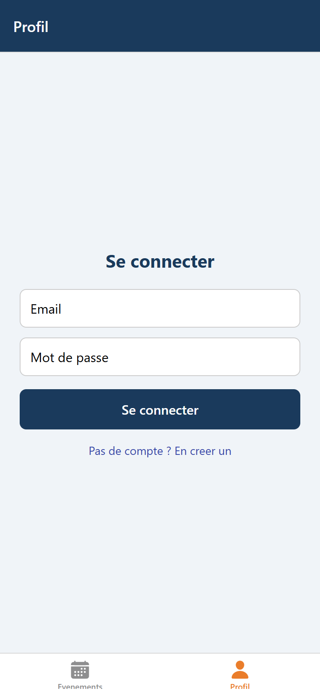

**Capture 2 — Bascule vers la création de compte.**

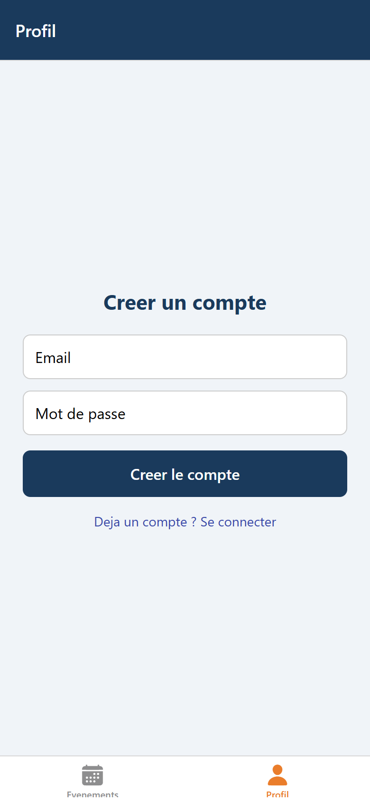

**Capture 3 — Session active : email et bouton de déconnexion.**

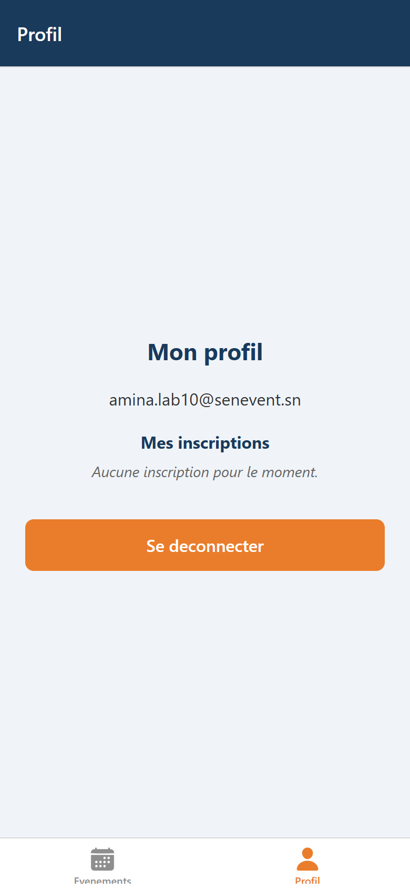

Le compte de démonstration créé depuis le mobile est `amina.lab10@senevent.sn`.
La session apparaît immédiatement après l'inscription, sans rechargement.

---

## 6. Étape 3 — Créer un événement depuis le mobile

### 6.1 Le bouton « + » dans l'en-tête

Le bouton n'est rendu que si `session` existe. Il utilise `useRouter` pour ouvrir `/nouveau`.

```javascript
function BoutonAjouter() {
  const { session } = useAuth();
  const router = useRouter();

  if (!session) return null;

  return (
    <Pressable
      onPress={() => router.push("/nouveau")}
      style={{ marginRight: 16 }}
    >
      <Ionicons name="add-circle" size={28} color="#fff" />
    </Pressable>
  );
}
```

Dans les options de l'onglet Événements :

```javascript
<Tabs.Screen
  name="index"
  options={{
    title: "Evenements",
    headerRight: () => <BoutonAjouter />,
    tabBarIcon: ({ color, size }) => (
      <Ionicons name="calendar" size={size} color={color} />
    ),
  }}
/>
```

**Capture 4 — Le bouton « + » est visible dans l'en-tête lorsque l'utilisateur est connecté.**

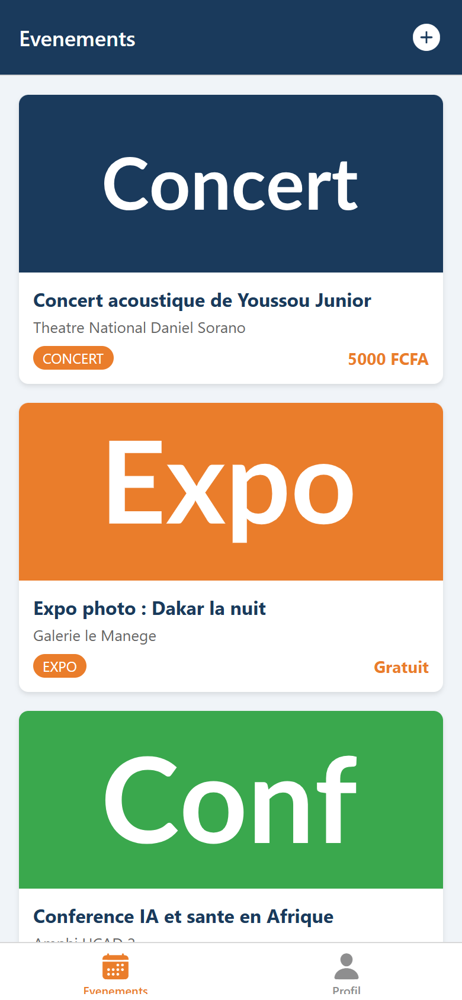

### 6.2 L'écran de création `apps/mobile/app/nouveau.js`

Le formulaire contient un titre, un sélecteur de catégorie en « chips », un lieu et un prix.
La catégorie est choisie parmi les cinq valeurs autorisées par la contrainte SQL.

```javascript
const CATEGORIES = ["concert", "expo", "conference", "atelier", "soutenance"];

const soumettre = async () => {
  setErreur(null);

  if (titre.trim().length < 3) {
    setErreur("Le titre doit faire au moins 3 caracteres.");
    return;
  }
  if (!session) {
    setErreur("Vous devez etre connecte.");
    return;
  }

  setEnCours(true);
  try {
    await creerEvenement({
      titre: titre.trim(),
      categorie,
      lieu_nom: lieu.trim(),
      date_debut: new Date().toISOString(),
      prix: Number(prix) || 0,
      organisateur_id: session.user.id,
    });
    router.back(); // retour a la liste
  } catch (e) {
    setErreur(e.message);
  } finally {
    setEnCours(false);
  }
};
```

Le sélecteur de catégorie utilise des `Pressable` et un style conditionnel :

```javascript
<Pressable
  key={c}
  style={[styles.chip, categorie === c && styles.chipActif]}
  onPress={() => setCategorie(c)}
>
  <Text style={categorie === c ? styles.chipTexteActif : styles.chipTexte}>
    {c}
  </Text>
</Pressable>
```

C'est l'équivalent React Native d'une classe CSS conditionnelle :
`[style1, condition && style2]`.

**Capture 5 — Écran de création vide.**

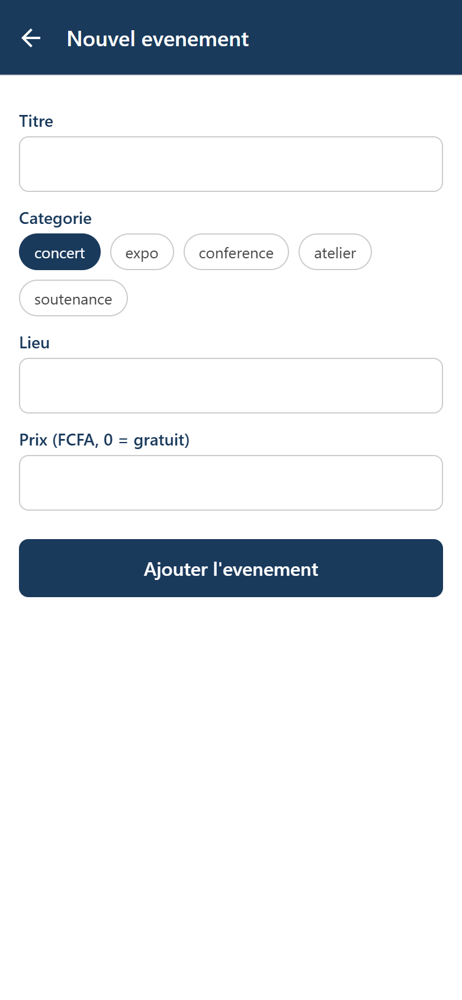

**Capture 6 — Formulaire rempli, catégorie « concert » sélectionnée.**

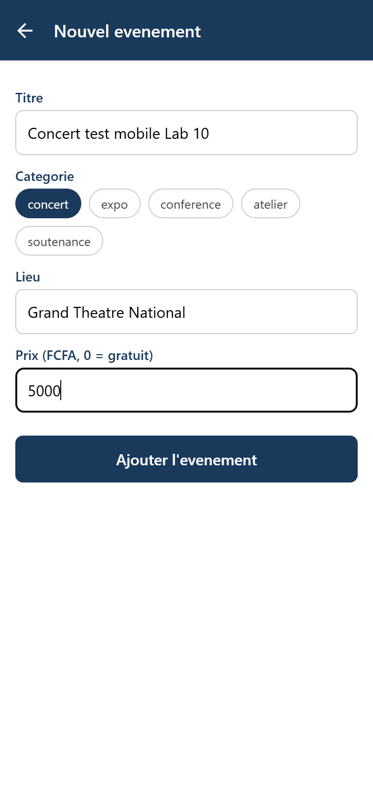

### 6.3 Rafraîchir la liste au retour : `useFocusEffect`

`useEffect(fn, [])` ne s'exécute qu'au montage. Sur mobile, un écran n'est pas démonté quand
on le quitte : il reste en mémoire. Au retour depuis l'écran de création, `useEffect` ne
relance donc pas le chargement. `useFocusEffect` exécute le code à chaque fois que l'écran
redevient visible.

```javascript
import { useState, useCallback } from "react";
import { useFocusEffect } from "expo-router";

useFocusEffect(
  useCallback(() => {
    const charger = async () => {
      try {
        const data = await getEvenements();
        setEvenements(data);
      } catch (e) {
        setErreur(e.message);
      } finally {
        setChargement(false);
      }
    };
    charger();
  }, [])
);
```

La fonction est enveloppée dans `useCallback` pour ne pas être recréée à chaque rendu.

**Capture 7 — Retour à la liste : l'événement créé sur le mobile est présent.**

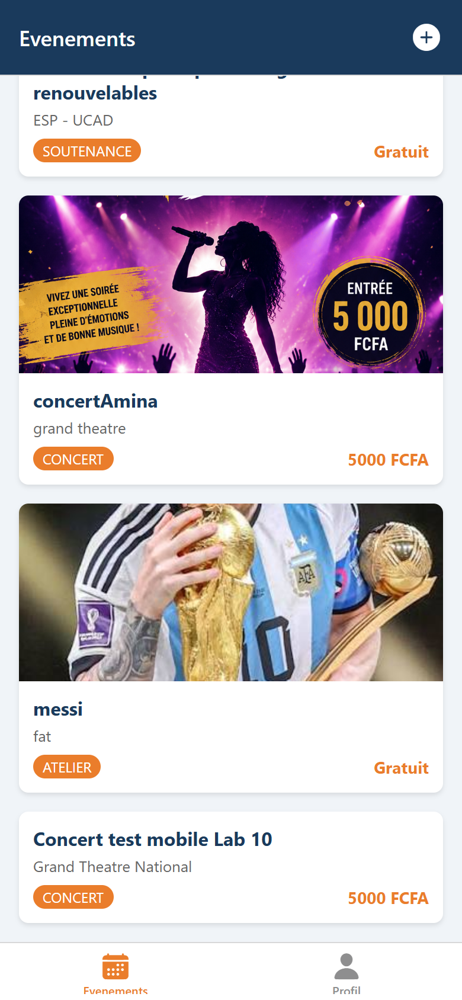

L'événement créé s'intitule **« Concert test mobile Lab 10 »**, catégorie `concert`,
lieu « Grand Theatre National », prix 5 000 FCFA. Il est enregistré dans la table
`evenements` de Supabase et apparaît aussi côté web (voir §9).

---

## 7. Étape 4 — S'inscrire à un événement

### 7.1 Le composant `BoutonInscription`

Le composant vérifie d'abord si l'utilisateur est déjà inscrit, puis bascule entre
`inscrire` et `desinscrire`. Sans session, il invite à se connecter.

```javascript
export default function BoutonInscription({ evenementId }) {
  const { session } = useAuth();
  const [inscrit, setInscrit] = useState(false);
  const [chargement, setChargement] = useState(true);

  useEffect(() => {
    const verifier = async () => {
      if (!session) {
        setChargement(false);
        return;
      }
      const resultat = await estInscrit(evenementId, session.user.id);
      setInscrit(resultat);
      setChargement(false);
    };
    verifier();
  }, [evenementId, session]);

  if (!session) {
    return (
      <Text style={styles.info}>
        Connectez-vous (onglet Profil) pour vous inscrire.
      </Text>
    );
  }

  if (chargement) {
    return <ActivityIndicator color="#1a3a5c" style={styles.marge} />;
  }

  const basculer = async () => {
    if (inscrit) {
      await desinscrire(evenementId, session.user.id);
      setInscrit(false);
    } else {
      await inscrire(evenementId, session.user.id);
      setInscrit(true);
    }
  };

  return (
    <Pressable
      style={[styles.bouton, inscrit ? styles.desinscrire : styles.inscrire]}
      onPress={basculer}
    >
      <Text style={styles.texte}>
        {inscrit ? "Se desinscrire" : "S'inscrire a cet evenement"}
      </Text>
    </Pressable>
  );
}
```

### 7.2 Intégration dans l'écran de détail

```javascript
import BoutonInscription from "../../components/BoutonInscription";

// ... apres le bloc Prix :
<BoutonInscription evenementId={evenement.id} />
```

**Capture 8 — Détail de l'événement avant inscription.**

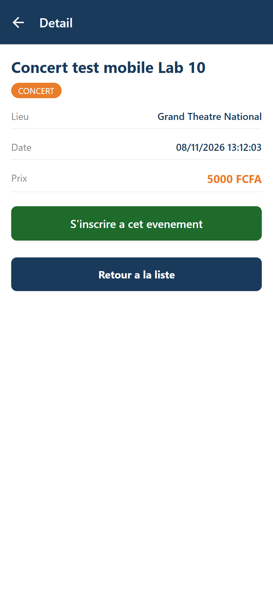

**Capture 9 — Après l'inscription : le bouton devient « Se désinscrire ».**

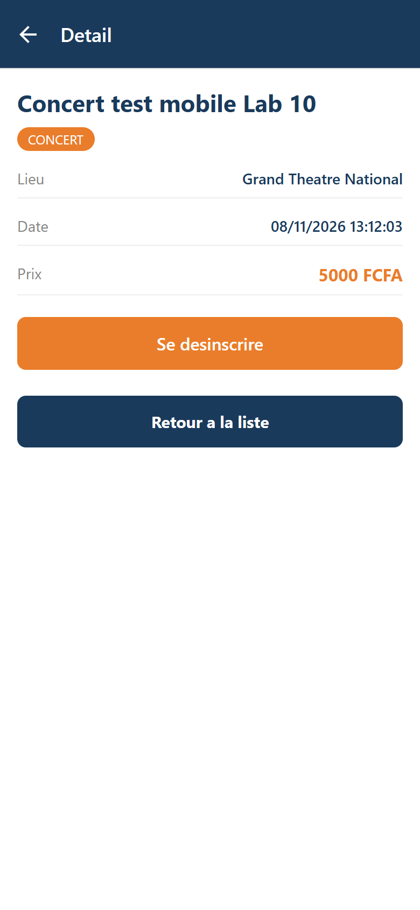

Côté base, une ligne a été insérée dans `inscriptions` :

```json
[
  {
    "id": 21,
    "evenement_id": 13,
    "utilisateur_id": "3571e1ac-0536-4a49-a869-cc09efe054cd",
    "created_at": "2026-11-08T13:12:06.415744+00:00"
  }
]
```

---

## 8. Bonus — « Mes inscriptions » dans le profil

Le bonus du lab consiste à afficher, dans le profil connecté, la liste des événements
auxquels l'utilisateur s'est inscrit.

### 8.1 Fonction partagée

```typescript
// packages/shared/src/inscriptions.ts
export async function mesInscriptions(utilisateurId: string): Promise<any[]> {
  const { data, error } = await getSupabase()
    .from("inscriptions")
    .select("evenement_id, evenements(titre, date_debut)")
    .eq("utilisateur_id", utilisateurId);

  if (error) throw error;
  return data ?? [];
}
```

La fonction est automatiquement disponible pour le web grâce au `export * from
"./inscriptions"` de `index.ts`. Une fonction, deux clients.

### 8.2 Affichage dans le profil

Le chargement est fait dans un `useFocusEffect` pour rafraîchir la liste quand on revient
sur l'onglet après une inscription :

```javascript
useFocusEffect(
  useCallback(() => {
    if (!session) {
      setInscriptions([]);
      return;
    }
    mesInscriptions(session.user.id)
      .then(setInscriptions)
      .catch(() => setInscriptions([]));
  }, [session])
);
```

**Capture 10 — Le profil connecté affiche « Mes inscriptions » avec l'événement rejoint.**

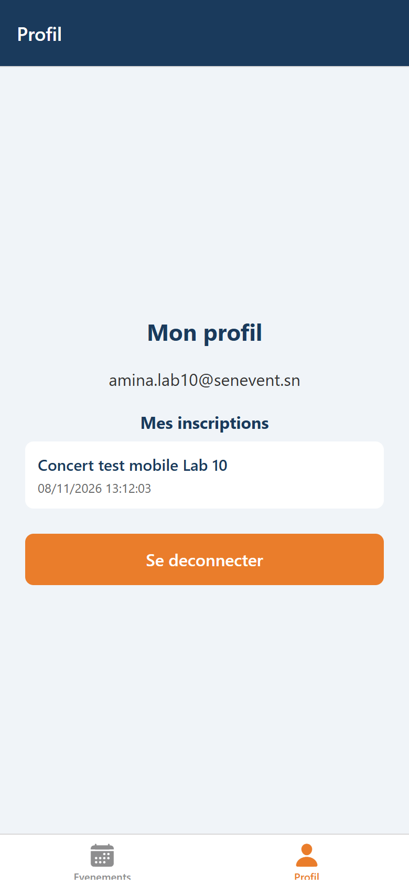

---

## 9. Preuve de l'architecture : deux clients, une seule base

### 9.1 Preuve côté Supabase

La capture suivante est produite à partir de l'API REST Supabase, avec la clé publique du
projet. Elle montre l'événement créé sur le mobile (id 13) et la ligne d'inscription
correspondante (id 21), dans les tables `evenements` et `inscriptions`.

**Capture 11 — Événement et inscription lus dans la même base Supabase.**

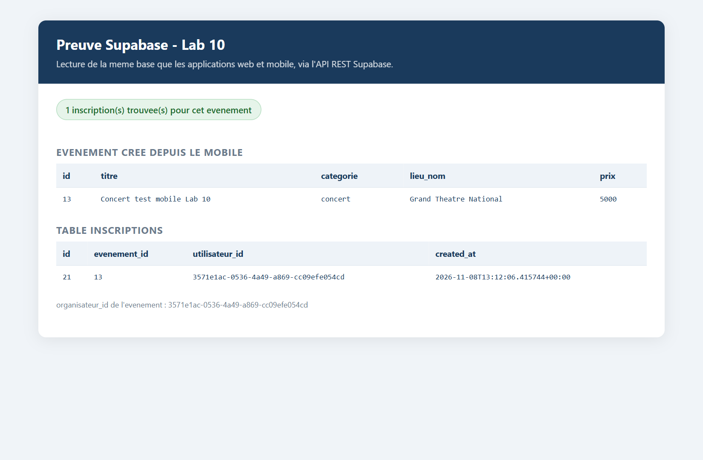

### 9.2 Démo croisée : le web voit ce que le mobile a créé

L'application web a été lancée sur `http://127.0.0.1:5173` et lit la même base. Sans même
se reconnecter, la liste web affiche l'événement **« Concert test mobile Lab 10 »** créé
depuis le mobile.

**Capture 12 — L'application web affiche l'événement créé sur le mobile.**

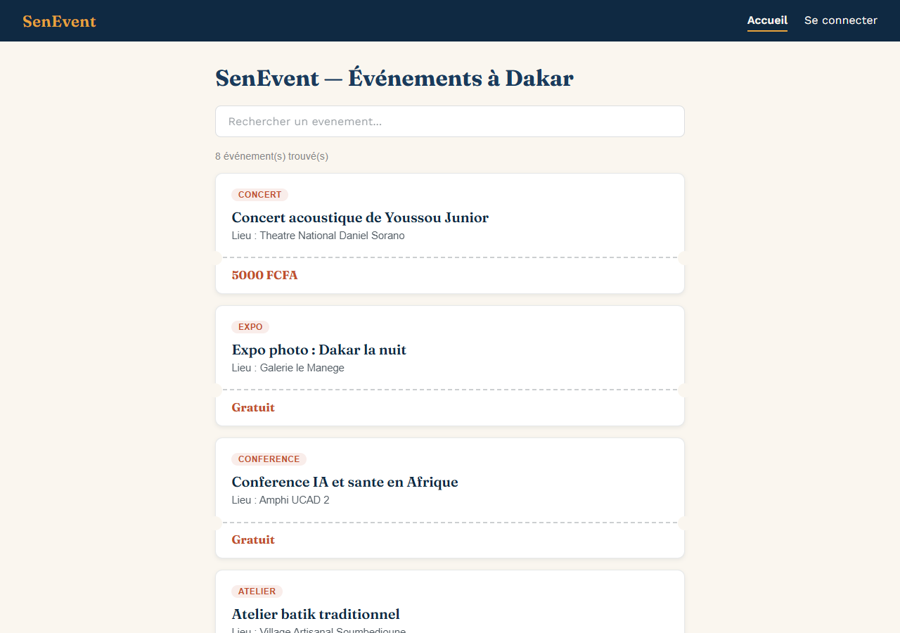

Après connexion sur le web avec le **même compte** (`amina.lab10@senevent.sn`), la page de
détail affiche **« Se désinscrire »** : l'inscription faite sur le mobile est bien visible
côté web.

**Capture 13 — L'inscription faite sur le mobile est visible sur le web.**

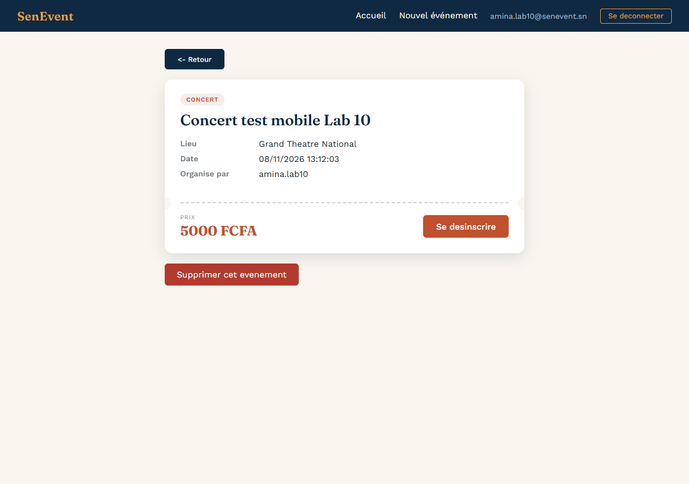

### 9.3 Vérification de l'architecture

Aucun appel Supabase direct n'a été ajouté dans `apps/mobile` :

```bash
$ grep -rc "supabase\.from\|createClient" apps/mobile
0
```

Tous les appels passent par `@senevent/shared` :

```bash
$ grep -rl "creerEvenement\|inscrire\|seConnecter" apps/mobile
apps/mobile/app/(tabs)/profil.js
apps/mobile/app/nouveau.js
apps/mobile/components/BoutonInscription.js
```

C'est exactement la promesse du monorepo : **le mobile n'a réécrit aucune logique métier**,
il a importé les mêmes fonctions et construit une interface native par-dessus.

---

## 10. Vérifications et checklist

| Point de la checklist | État |
|---|---|
| `context/AuthContext.js` expose `AuthProvider` et `useAuth` | ✓ |
| `app/_layout.js` enveloppe le `Stack` dans `AuthProvider` | ✓ |
| L'onglet Profil montre le formulaire (déconnecté) ou l'email + déconnexion (connecté) | ✓ |
| Le formulaire utilise `TextInput` et `KeyboardAvoidingView` | ✓ |
| La connexion / inscription passe par `seConnecter` / `sInscrire` | ✓ |
| Un bouton « + » apparaît dans l'en-tête, seulement si connecté | ✓ |
| L'écran `nouveau.js` crée un événement via `creerEvenement` | ✓ |
| La liste se rafraîchit au retour grâce à `useFocusEffect` | ✓ |
| L'écran de détail a un `BoutonInscription` (`inscrire` / `desinscrire`) | ✓ |
| Aucun appel Supabase direct dans `apps/mobile` | ✓ (0) |
| Au moins trois commits dans l'historique du lab | ✓ (5 commits Lab 10) |
| Le tag `v0.10-mobile-crud` est posé sur `main` | ✓ |

Commandes de vérification côté enseignant :

```bash
$ git shortlog -sne v0.9-router..v0.10-mobile-crud
     6  Aminata Diouf <aminata21diouf@gmail.com>

$ git log v0.9-router..v0.10-mobile-crud --oneline
c0f07bb bouton d'inscription a un evenement sur mobile
c261742 creation d'evenement mobile + bouton header + refresh au focus
515b6d1 ecran Profil : connexion, inscription, deconnexion mobile (+ bonus mes inscriptions)
63378fc contexte d'authentification (AuthProvider + useAuth)
9222d6c chore: ajoute le support web pour tester l'app dans le navigateur
bc24efe bonus : navigation par code avec useRouter (bouton retour a la liste)

$ test -f apps/mobile/context/AuthContext.js && echo OK || echo MANQUE
OK
```

L'intervalle `v0.9-router..v0.10-mobile-crud` contient 6 commits : les 5 commits du Lab 10,
plus `bc24efe` (bonus de navigation du Lab 9, posé après le tag `v0.9-router`).

---

## 11. Git et tag de fin de lab

### 11.1 Commits

| Commit | Message |
|---|---|
| `9222d6c` | `chore: ajoute le support web pour tester l'app dans le navigateur` |
| `63378fc` | `contexte d'authentification (AuthProvider + useAuth)` |
| `515b6d1` | `ecran Profil : connexion, inscription, deconnexion mobile (+ bonus mes inscriptions)` |
| `c261742` | `creation d'evenement mobile + bouton header + refresh au focus` |
| `c0f07bb` | `bouton d'inscription a un evenement sur mobile` |
| `e334088` | `Merge Lab 10 : auth et CRUD complet mobile` |

### 11.2 Tag

```bash
git checkout main
git merge --no-ff feature/lab10-mobile-crud
git tag -a v0.10-mobile-crud -m "Lab 10 termine : auth et CRUD complet mobile"
```

Le tag `v0.10-mobile-crud` est posé sur `main` au commit de merge `e334088`.

### 11.3 Publication

```bash
git push origin main
git push origin v0.10-mobile-crud
```

---

## 12. Conclusion

Le Lab 10 complète la partie mobile du projet SenEvent. L'application sait désormais :

- se connecter et créer un compte depuis l'onglet Profil ;
- créer un événement depuis le bouton « + » de l'en-tête ;
- s'inscrire et se désinscrire d'un événement depuis l'écran de détail ;
- afficher « Mes inscriptions » dans le profil (bonus).

Toutes ces actions passent par `@senevent/shared`, sans aucun appel Supabase direct dans
`apps/mobile`. La démonstration croisée le confirme : un événement créé sur le mobile est
visible sur le web, et une inscription faite sur le mobile est visible sur le web. Les deux
clients font la même chose, sur la même base, avec une seule logique métier.

**Tag posé :** `v0.10-mobile-crud`.

---

## Annexes

### A. Structure finale de `apps/mobile`

```text
apps/mobile/
├── app/
│   ├── _layout.js              # Stack + AuthProvider + initSupabase
│   ├── nouveau.js              # ecran de creation d'evenement
│   ├── (tabs)/
│   │   ├── _layout.js          # Tabs + bouton "+" (headerRight)
│   │   ├── index.js            # liste (useFocusEffect)
│   │   └── profil.js           # connexion / inscription / deconnexion + bonus
│   └── evenement/
│       └── [id].js             # detail + BoutonInscription
├── components/
│   ├── EvenementCarte.js       # carte cliquable
│   └── BoutonInscription.js    # inscription a un evenement
├── context/
│   └── AuthContext.js          # AuthProvider + useAuth
├── metro.config.js
├── app.json
└── package.json
```

### B. Lancer le projet

```bash
# Mobile (Expo Go ou navigateur)
cd apps/mobile
npx expo start
# ou, pour le rendu navigateur :
npx expo start --web --port 8081

# Web (Vite)
cd apps/web
npm run dev
```

### C. Compte de démonstration

| Champ | Valeur |
|---|---|
| Email | `amina.lab10@senevent.sn` |
| Mot de passe | `Lab10Senevent!` |
| Événement créé | « Concert test mobile Lab 10 » (id 13) |
| Inscription | id 21, sur l'événement 13 |

### D. Remarques

- Le support web (`react-native-web`, `react-dom`, `@expo/metro-runtime`) a été ajouté
  uniquement pour exécuter l'application dans un navigateur et produire les captures. Le
  code applicatif reste du React Native standard.
- La fonction `creerProfil` a été ajoutée au package partagé pour créer la ligne `profiles`
  attendue par la clé étrangère `evenements.organisateur_id`. Sans elle, un compte créé
  depuis le mobile ne pourrait pas créer d'événement.
- Le bonus « Mes inscriptions » est implémenté dans `profil.js` avec `mesInscriptions`,
  ajouté au package partagé et donc également disponible pour le web.
