# Rapport — Lab 12
## Build mobile avec EAS : l'APK Android

**Aminata Diouf — Étudiante en Master 1 RETEL, UCAD**
**DAWM — Développement d'Applications Web & Mobile — 2025-2026**

| | |
|---|---|
| **Auteure** | Aminata Diouf |
| **Université** | Université Cheikh Anta Diop de Dakar (UCAD) |
| **Faculté** | Faculté des Sciences et Techniques |
| **Département** | Département de Mathématiques et Informatique |
| **Formation** | Master 1 RETEL |
| **Date** | 8 novembre 2026 |
| **Dépôt** | `senevent` |
| **Branche du lab** | `feature/lab12-eas` |
| **Tag de sortie** | `v2.0` |
| **Application** | `apps/mobile` (Expo / React Native) |
| **APK Android** | expo.dev — build `c2892286` (profil `preview`) |

---

## Résumé

Ce dernier lab transforme l'application mobile en **vraie application Android installable**.
Jusqu'ici, SenEvent mobile tournait dans Expo Go : un QR code, un serveur de développement sur
l'ordinateur, et l'application disparaissait dès que l'ordinateur s'éteignait. Le lab produit
un **APK** construit sur les serveurs d'**EAS Build**, installable sur un téléphone, qui
fonctionne sans ordinateur et sans Expo Go.

Le travail couvre huit étapes :

1. **Vérifier** la configuration (`expo-doctor`) et créer la branche `feature/lab12-eas`.
2. **Compte Expo et EAS CLI** : compte `babyamina`, projet `@babyamina/senevent`.
3. **Identité de l'application** dans `app.json` : nom, version, `android.package`.
4. **Profils de build** dans `eas.json`, avec un profil `preview` qui produit un APK.
5. **Variables EAS** `EXPO_PUBLIC_*` dans l'environnement `preview`.
6. **Session persistante** sur mobile avec AsyncStorage, sans changer le web.
7. **Build EAS** et **recette** de production.
8. **README**, Pull Request et tag final `v2.0`.

Le résultat est une application Android signée, téléchargeable, qui partage la même base
Supabase et le même package `@senevent/shared` que le site Vercel.

| Indicateur | Valeur |
|---|---|
| Projet Expo | `@babyamina/senevent` |
| Identifiant EAS | `d5de33b6-e341-4e8d-a099-a55f63d284f1` |
| Identifiant Android | `sn.ucad.senevent.equipe1` |
| Version mobile | `1.0.0` (versionCode 1) |
| Profil de build | `preview` — APK, distribution interne |
| Build EAS | `FINISHED` — 10 min 9 s |
| APK | 64,99 Mo — SHA-256 `eef7f0e2…ba2a` |
| Site web | <https://senevent-equipe-1.vercel.app> |
| Tag final | `v2.0` |

---

## 1. Contexte et objectif

### 1.1 Expo Go n'est pas une application

Depuis le Lab 8, le mobile se lance avec `npx expo start` et s'ouvre dans **Expo Go**. C'est un
excellent outil de développement : le code se recharge à chaque sauvegarde. Mais Expo Go est
une application hôte : elle ne contient pas *votre* application, elle exécute le JavaScript
envoyé par le serveur de développement.

| | Expo Go | APK |
|---|---|---|
| Contenu | Le moteur Expo, pas votre code | Moteur React Native + modules natifs + votre JavaScript |
| Démarrage | QR code + serveur sur l'ordinateur | Icône sur le téléphone, aucun ordinateur |
| Partage | Impossible hors de l'équipe | Fichier installable, envoyé par WhatsApp |
| Identité | Celle d'Expo Go | Nom, icône et identifiant propres |

### 1.2 EAS Build : compiler sans Android Studio

Produire un APK demande normalement Android Studio, le SDK Android, Java et Gradle. **EAS
Build** fait cette compilation sur les serveurs d'Expo : la machine envoie le dépôt, EAS
installe les dépendances du monorepo, injecte les variables de l'environnement choisi, assemble
le JavaScript avec Metro, compile avec Gradle, puis renvoie un APK signé.

```text
machine                      serveurs EAS Build                résultat
eas build --profile preview  →  npm install (monorepo)      →  APK signé
envoie les fichiers Git         variables EXPO_PUBLIC_*          lien + QR code
.env reste local                Metro + Gradle                   installable
```

### 1.3 Le monorepo sur les serveurs EAS

La commande est lancée depuis `apps/mobile`, mais EAS envoie **tout le dépôt**, de la racine.
C'est ce qui permet d'installer les workspaces npm et de lier `@senevent/shared`. Le fichier
`package-lock.json` unique à la racine, vérifié au Lab 11, est donc aussi indispensable ici.

---

## 2. Étape 0 — Vérification et branche du lab

La branche part de `main`, qui contient le Lab 11 terminé : site Vercel en production et tag
`v1.0-web`.

```bash
git checkout main
git pull origin main
git log --oneline -6
git checkout -b feature/lab12-eas
```

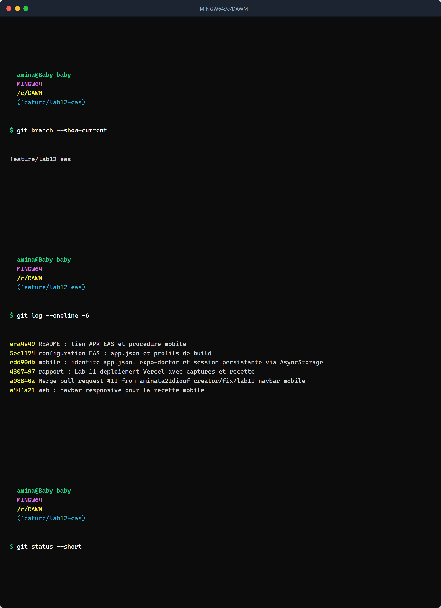

La branche part du commit `4307497` (rapport du Lab 11). Le code mobile est celui du Lab 10 :
catalogue, détail, connexion, création et inscription.

L'application mobile avait été validée dans Expo Go au Lab 10 : les écrans du catalogue, du
détail, de la connexion et de la création répondaient. Aucun blocage fonctionnel n'était
connu au départ de ce lab. Un bug présent à ce stade serait compilé dans l'APK, et chaque
nouveau build consomme du quota : la vérification de configuration (section 4.2) précède donc
le build.

---

## 3. Étape 1 — Compte Expo et EAS CLI

### 3.1 Le compte

Le compte Expo est **`babyamina`**. Il est propriétaire du projet et des builds. La connexion
a été faite par la propriétaire du compte avec `eas login` ; aucun mot de passe ni jeton n'est
stocké dans le dépôt.

```bash
npx eas-cli whoami
# babyamina
```

Le compte expose deux espaces : `babyamina` (personnel) et `babyaminas-team` (organisation).
Le projet est créé dans l'espace personnel, ce qui évite de dépendre d'une organisation pour
un lab individuel.

### 3.2 L'outil en ligne de commande

EAS CLI est utilisé via `npx eas-cli`, sans installation globale. La version est figée par
`eas.json` (`"cli": { "version": ">= 27.5.0" }`), donc tous les builds utilisent une CLI
compatible.

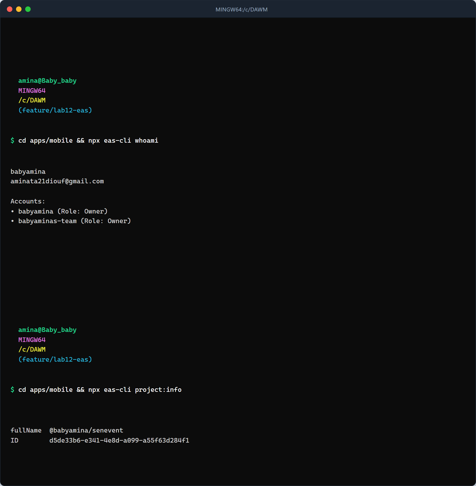

`eas whoami` confirme l'identité, `eas project:info` confirme le projet lié et son identifiant.

---

## 4. Étape 2 — Préparer `app.json`

Jusqu'ici, `app.json` ne servait qu'à Expo Go. Une application installable a besoin d'une
identité propre.

```json
{
  "expo": {
    "name": "SenEvent",
    "slug": "senevent",
    "scheme": "senevent",
    "version": "1.0.0",
    "orientation": "portrait",
    "icon": "./assets/icon.png",
    "android": {
      "package": "sn.ucad.senevent.equipe1",
      "adaptiveIcon": {
        "foregroundImage": "./assets/adaptive-icon.png",
        "backgroundColor": "#1a3a5c"
      }
    }
  }
}
```

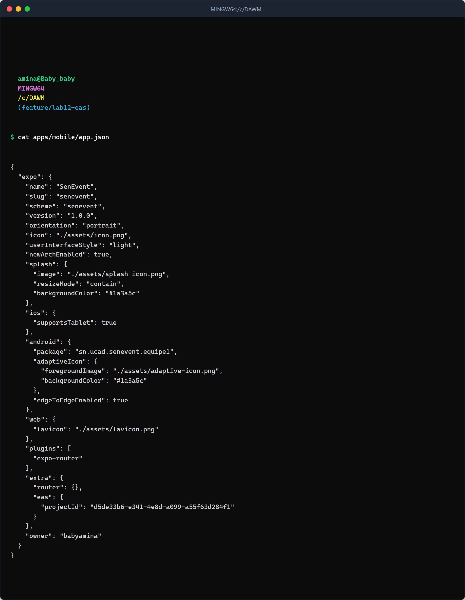

### 4.1 Les trois champs qui comptent

| Champ | Rôle | Valeur choisie |
|---|---|---|
| `name` | Nom affiché sous l'icône | `SenEvent` |
| `version` | Version visible par l'utilisateur | `1.0.0` |
| `android.package` | Identifiant unique sur Android, en nom de domaine inversé | `sn.ucad.senevent.equipe1` |

Le `package` est **définitif** : deux applications qui partagent le même identifiant se
remplacent sur le téléphone. Il porte l'université (`sn.ucad`), le projet (`senevent`) et le
numéro d'équipe (`equipe1`).

Le `scheme` `senevent` permet les liens profonds, et la couleur adaptative reprend le bleu de
la charte (`#1a3a5c`).

### 4.2 Le diagnostic avant le build

`expo-doctor` vérifie la cohérence des versions et de la configuration. Au premier passage,
**16 contrôles sur 18** seulement passaient :

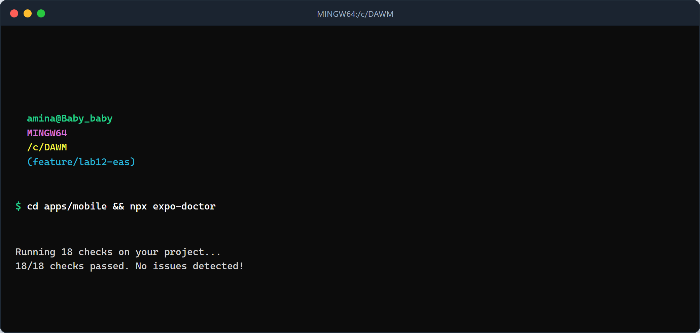

Deux problèmes réels ont été corrigés avant de consommer un build :

1. **Metro** : `watchFolders` écrasait les dossiers surveillés par défaut d'Expo. La correction
   ajoute la racine du monorepo **sans** supprimer les valeurs par défaut :

   ```js
   config.watchFolders = Array.from(
     new Set([...(config.watchFolders || []), monorepoRoot])
   );
   ```

2. **Versions** : `expo` et `expo-constants` avaient une version de patch en retard. Ils ont
   été alignés sur le SDK 54 avec `npx expo install expo@~54.0.37 expo-constants@~18.0.14`.

Après correction, `expo-doctor` affiche **18/18, aucun problème**. Un build EAS échoué après
vingt minutes de file d'attente coûte cher : ce diagnostic est un investissement, pas une
formalité.

---

## 5. Étape 3 — Relier le projet à EAS et écrire `eas.json`

### 5.1 `eas init`

Depuis `apps/mobile`, `eas init` crée le projet sur expo.dev et ajoute dans `app.json`
l'identifiant de projet et le propriétaire :

```json
"extra": {
  "eas": { "projectId": "d5de33b6-e341-4e8d-a099-a55f63d284f1" }
},
"owner": "babyamina"
```

Ces deux champs sont versionnés : toute l'équipe pointe vers le même projet EAS.

### 5.2 Les profils de build

`eas build:configure --platform android` génère `eas.json`. Seul le profil `preview` a été
modifié pour produire un APK :

```json
{
  "cli": {
    "version": ">= 27.5.0",
    "appVersionSource": "remote"
  },
  "build": {
    "development": {
      "developmentClient": true,
      "distribution": "internal"
    },
    "preview": {
      "distribution": "internal",
      "environment": "preview",
      "android": { "buildType": "apk" }
    },
    "production": {
      "environment": "production",
      "autoIncrement": true
    }
  }
}
```

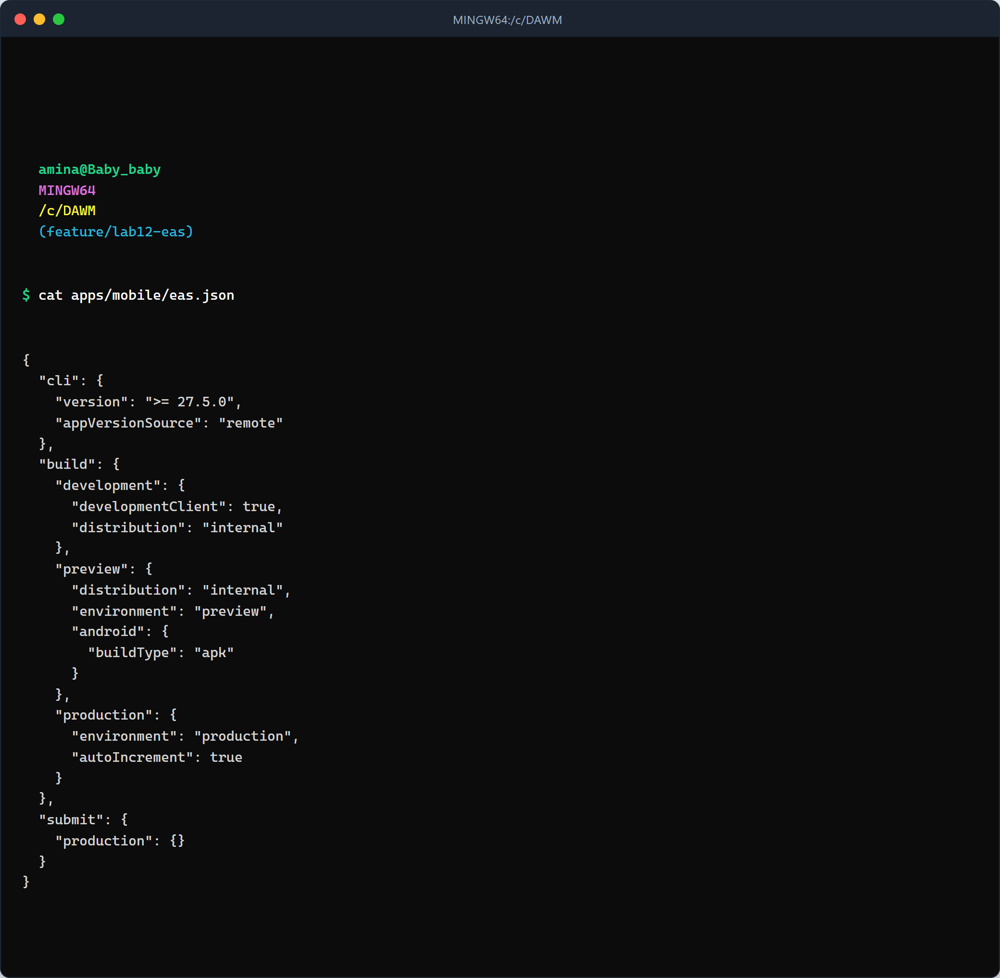

| Profil | Sortie | Usage |
|---|---|---|
| `development` | Client de développement | Non utilisé dans ce cours |
| `preview` | **APK** (`buildType: apk`), distribution interne | Livrable du lab |
| `production` | AAB, incrément automatique | Google Play, non installable directement |

La ligne `"buildType": "apk"` est essentielle : sans elle, EAS produit un **AAB**, le format du
Play Store, qu'on ne peut pas installer sur un téléphone.

---

## 6. Étape 4 — Les variables d'environnement EAS

### 6.1 Le piège

Les clés Supabase du mobile sont dans `apps/mobile/.env`, ignoré par Git. Or EAS n'envoie que
les fichiers suivis par Git. Sur les serveurs EAS, `process.env.EXPO_PUBLIC_SUPABASE_URL`
vaut `undefined` : l'APK s'installe, s'ouvre, puis s'arrête sur `supabaseUrl is required`.

C'est exactement le problème du Lab 11 avec Vercel, et la solution est la même : déclarer les
variables chez le service qui construit.

### 6.2 Déclaration dans l'environnement `preview`

```bash
eas env:set --name EXPO_PUBLIC_SUPABASE_URL \
  --value https://oymhcmowujakgyqpkpjc.supabase.co \
  --environment preview --visibility plaintext

eas env:set --name EXPO_PUBLIC_SUPABASE_ANON_KEY \
  --value sb_publishable_... \
  --environment preview --visibility plaintext

eas env:list --environment preview
```

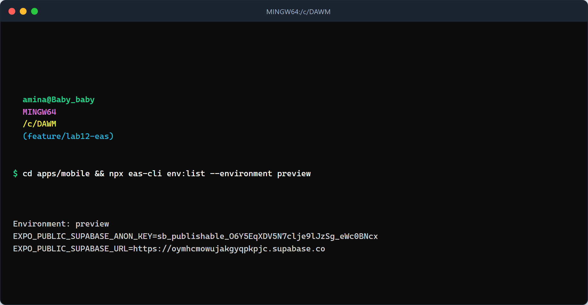

Le profil `preview` de `eas.json` déclare `"environment": "preview"` : chaque build de ce profil
reçoit ces deux variables. Aucun fichier du dépôt n'est modifié ; les valeurs vivent sur
expo.dev.

La clé utilisée est une clé **publishable** (`sb_publishable_...`). Comme `VITE_` au Lab 11,
une variable `EXPO_PUBLIC_` est écrite en clair dans le JavaScript : n'importe qui peut
extraire un APK et la lire. C'est sans danger pour cette clé, protégée par les politiques RLS.
La clé `service_role`, qui contourne RLS, n'apparaît jamais dans une application mobile.

---

## 7. Étape 5 — Une session qui survit à la fermeture

### 7.1 Le défaut

Dans Expo Go, on se reconnectait sans y penser. Dans une vraie application, devoir saisir son
mot de passe à chaque ouverture est inacceptable.

Sur le web, le client Supabase range la session dans le `localStorage` : elle survit au
rechargement. React Native n'a pas de `localStorage`. Sans indication, le client garde la
session **en mémoire**, et elle disparaît avec l'application. L'équivalent mobile est
**AsyncStorage**, un stockage clé-valeur persistant propre à l'application.

### 7.2 Le package partagé accepte des options

`initSupabase` reçoit un troisième paramètre optionnel. Le web, qui appelle toujours avec deux
arguments, garde exactement son comportement d'avant.

```ts
export function initSupabase(
  url: string,
  anonKey: string,
  options?: SupabaseClientOptions<"public">
): SupabaseClient<Database> {
  if (!client) {
    client = createClient<Database>(url, anonKey, options);
  }
  return client;
}
```

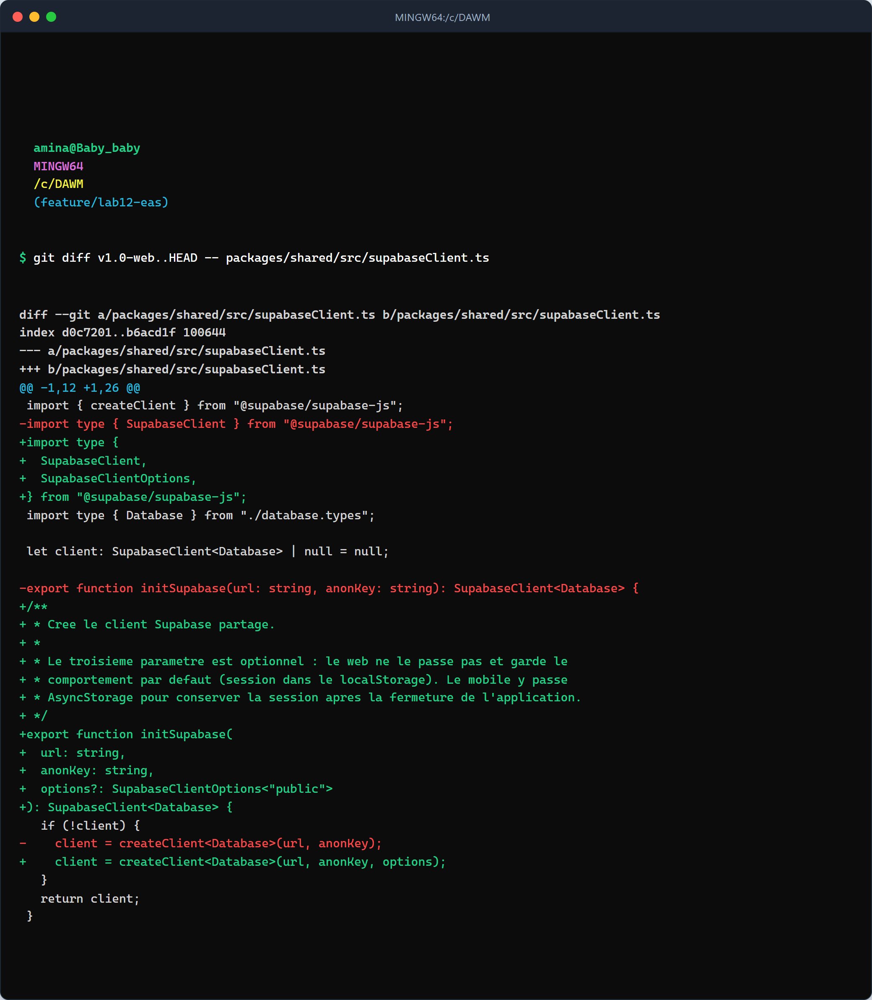

C'est le principe du Lab 7 : le package ne sait pas sur quelle plateforme il tourne, c'est
chaque application qui lui fournit ce dont elle a besoin.

### 7.3 Le mobile passe AsyncStorage

```bash
npx expo install @react-native-async-storage/async-storage
```

```js
initSupabase(
  process.env.EXPO_PUBLIC_SUPABASE_URL,
  process.env.EXPO_PUBLIC_SUPABASE_ANON_KEY,
  {
    auth: {
      storage: AsyncStorage,
      persistSession: true,
      autoRefreshToken: true,
      detectSessionInUrl: false,
    },
  }
);
```

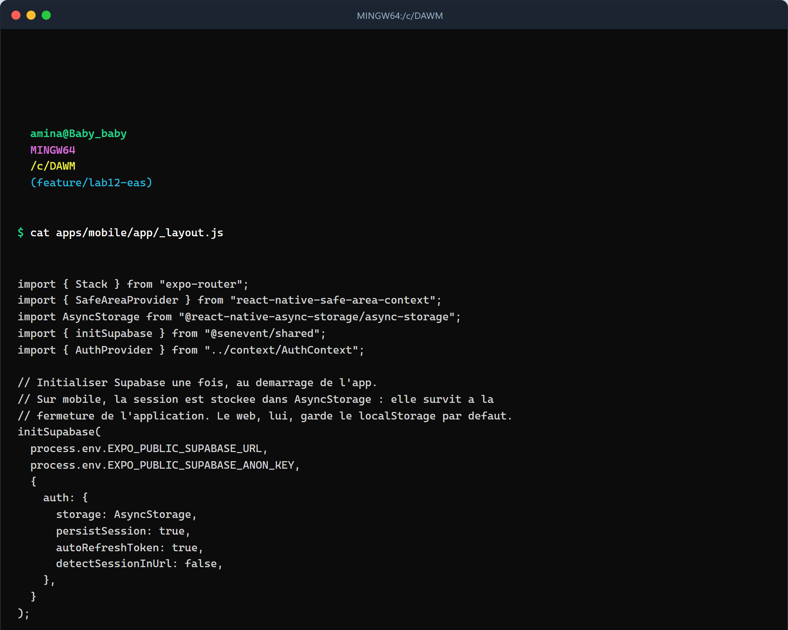

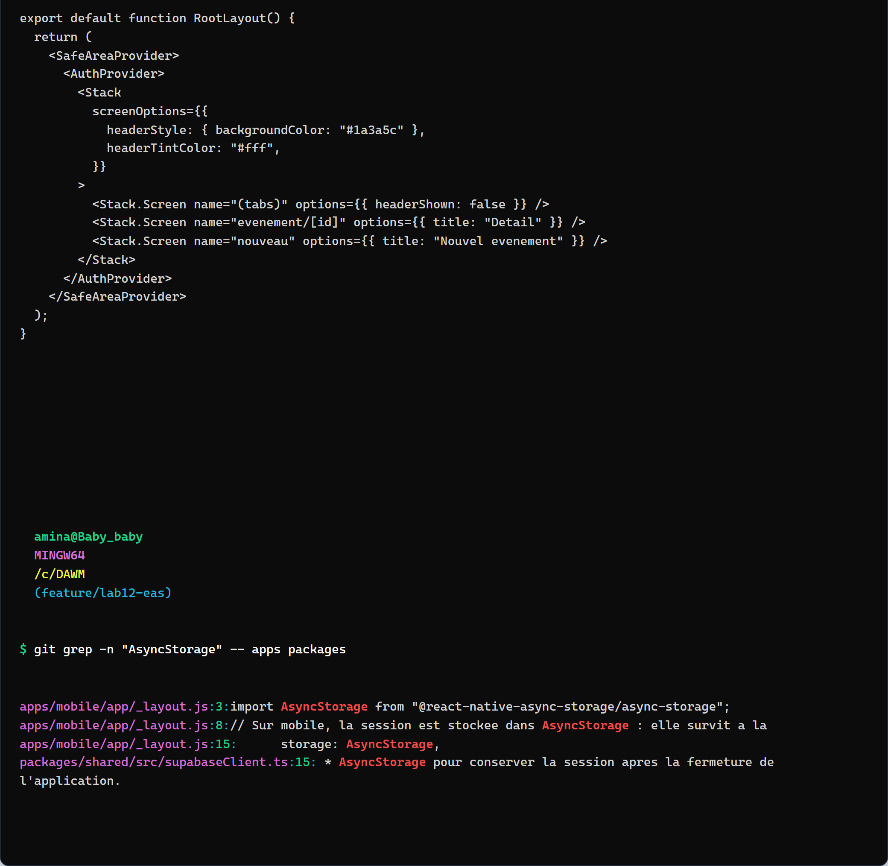

| Réglage | Rôle |
|---|---|
| `storage` | Où ranger la session : AsyncStorage |
| `persistSession` | La relire au démarrage |
| `autoRefreshToken` | Renouveler le jeton avant expiration |
| `detectSessionInUrl` | Désactivé : une application mobile ne reçoit pas la session dans une URL |

Le `AuthProvider` du Lab 10 n'a pas changé : au démarrage, `getSession()` lit maintenant la
session dans AsyncStorage.

### 7.4 Vérifier que le web n'a pas bougé

Le changement touche `packages/shared`, donc les deux clients. Deux vérifications ont été
faites :

1. **Build web** : `tsc -b && vite build` passe (91 modules, 443 kB de JavaScript).
2. **Prévisualisation Vercel de la PR** : connexion avec un compte réel, puis rechargement
   complet de la page. La session est toujours active et se trouve dans le `localStorage`
   (clé `sb-oymhcmowujakgyqpkpjc-auth-token`).

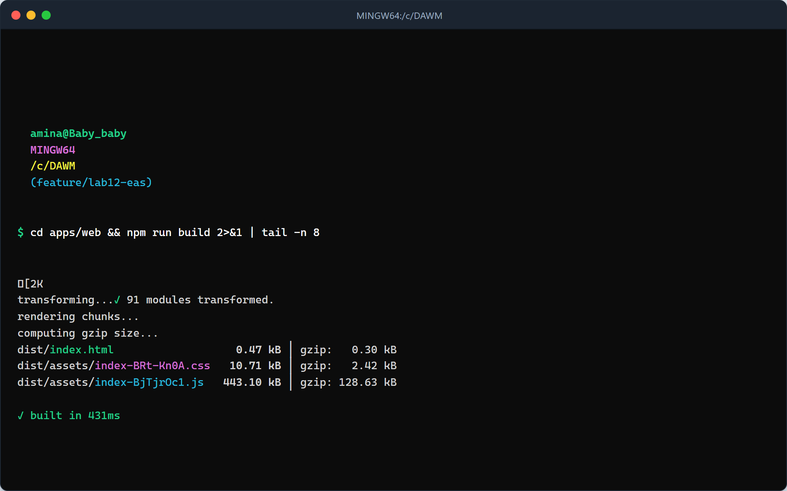

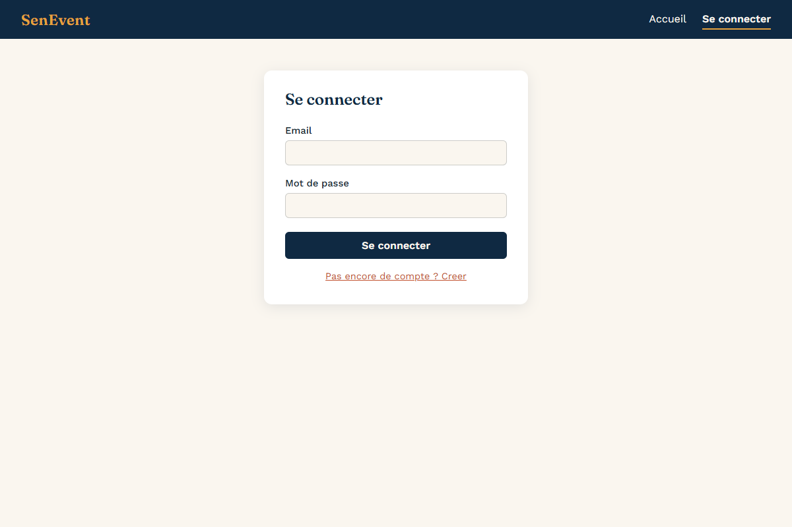

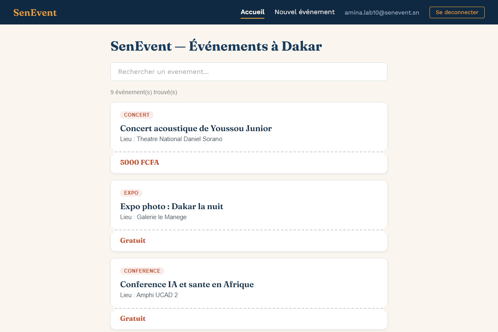

Le web n'a donc pas changé de comportement : il utilise toujours le `localStorage`, tandis que
le mobile utilise AsyncStorage.

---

## 8. Étape 6 — Lancer le build

### 8.1 La commande

Le build part du contenu de la branche, dont le code est identique à celui qui sera mergé :

```bash
git checkout main
git pull origin main
cd apps/mobile
eas build --platform android --profile preview
```

À la première exécution, EAS crée le **keystore** Android, la clé qui signe l'application, et
le conserve pour les builds suivants. La version initiale du `versionCode` est fixée à **1**.

### 8.2 Ce que fait EAS

Le journal du build montre les étapes réelles, avec leur durée mesurée :

| Phase EAS | Durée | Contenu |
|---|---|---|
| `INSTALL_DEPENDENCIES` | 47,7 s | `npm ci --include=dev` sur le monorepo |
| `RUN_EXPO_DOCTOR` | 4,2 s | diagnostic de configuration |
| `PREBUILD` | 9,3 s | génération du projet Android natif |
| `EAGER_BUNDLE` | 16,8 s | Metro : 1 096 modules, bundle en 11,1 s |
| `RUN_GRADLEW` | 514,3 s | `gradlew :app:assembleRelease`, 335 tâches |
| `UPLOAD_APPLICATION_ARCHIVE` | 3,0 s | envoi de l'APK de 65,0 Mo |

1. lecture de l'environnement `preview` et des deux variables `EXPO_PUBLIC_*` ;
2. initialisation du `versionCode` à 1 (versions distantes) ;
3. création du keystore Android ;
4. compression et envoi du dépôt (**50,4 Mo**, rapports compris) en 31 secondes ;
5. calcul de l'empreinte du projet (fingerprint) ;
6. mise en file d'attente, installation, bundle Metro, compilation Gradle ;
7. `BUILD SUCCESSFUL in 8m 33s`, puis publication de l'APK et de son QR code.

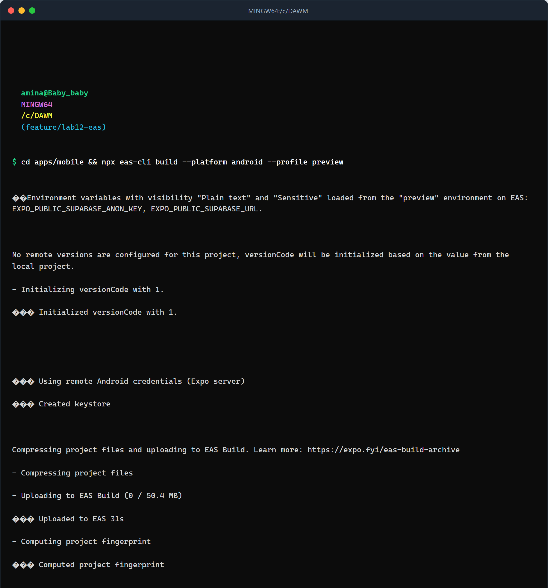

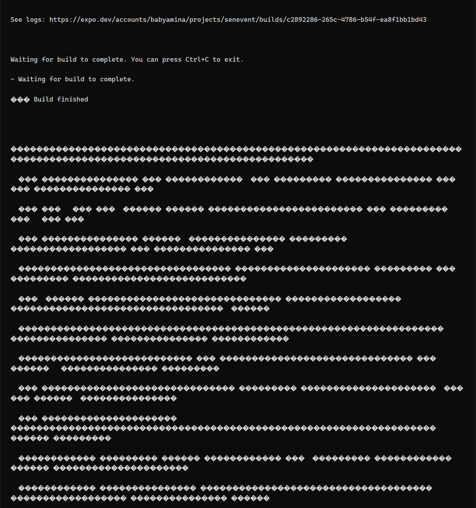

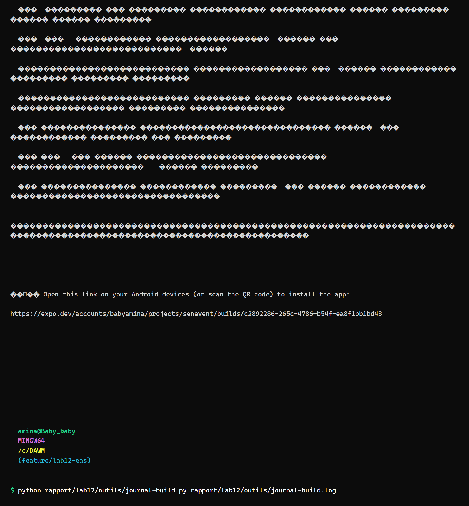

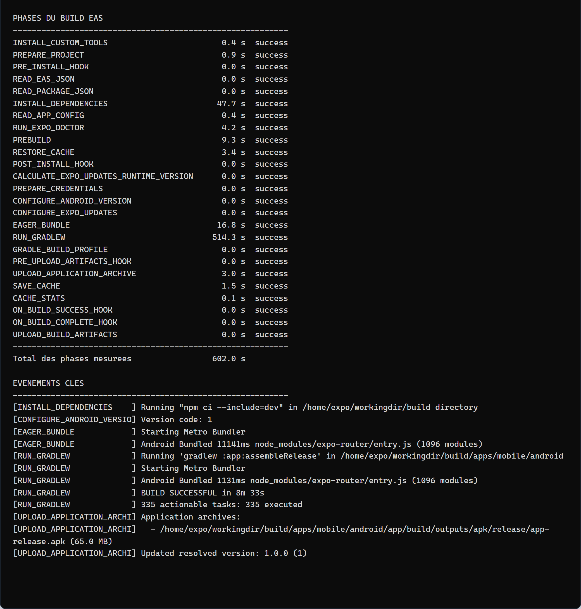

Le build est visible sur expo.dev :

<https://expo.dev/accounts/babyamina/projects/senevent/builds/c2892286-265c-4786-b54f-ea8f1bb1bd43>

### 8.3 Le résultat

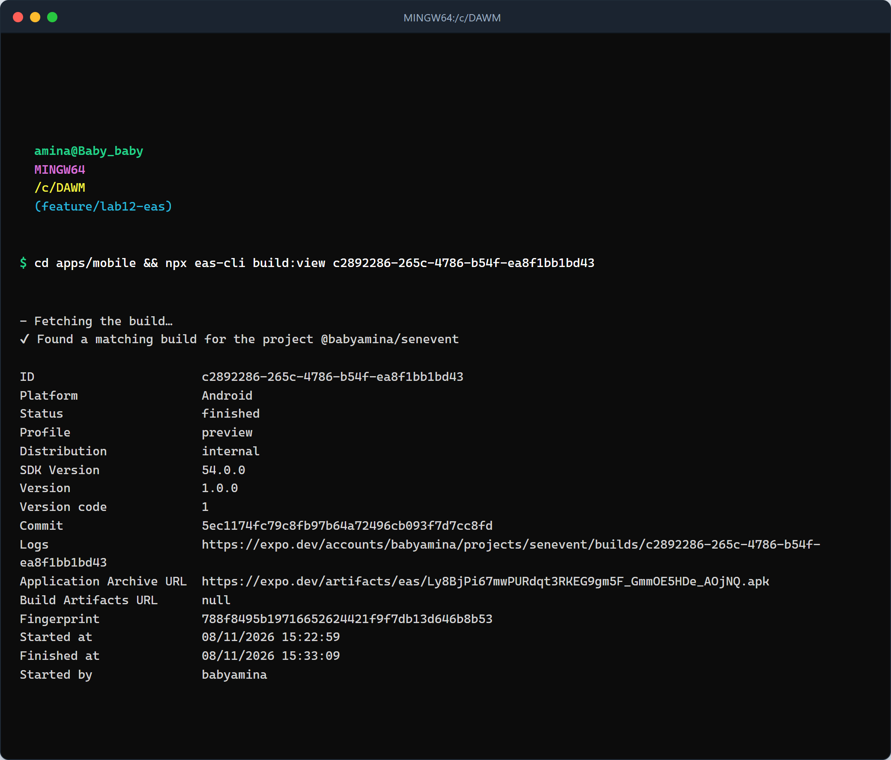

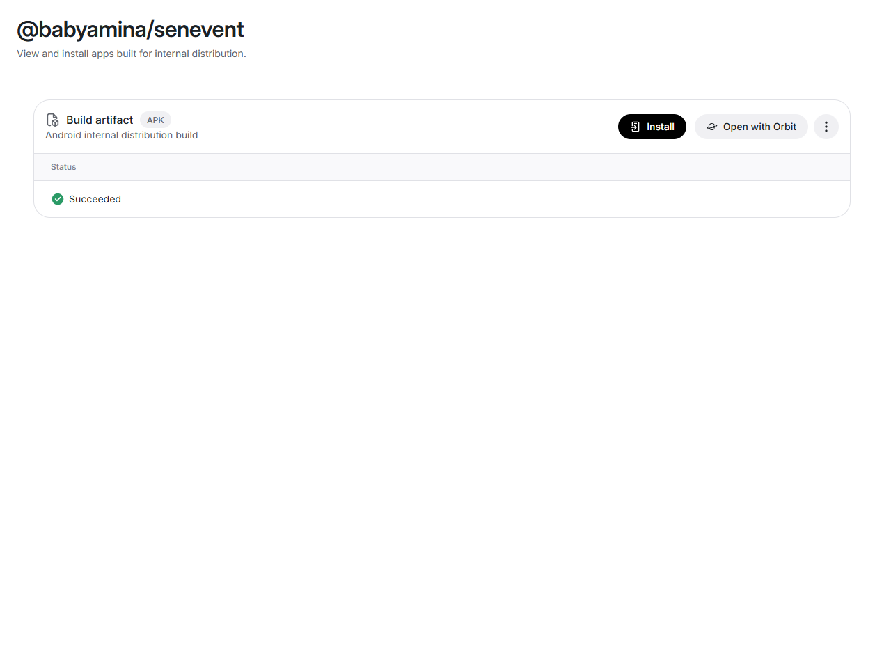

| Propriété | Valeur |
|---|---|
| Statut | `FINISHED` (succès) |
| Plateforme | Android |
| Profil | `preview` (distribution interne) |
| SDK Expo | 54.0.0 |
| Version | `1.0.0`, versionCode 1 |
| Commit construit | `5ec1174` |
| Durée | 10 min 9 s (15:22:59 → 15:33:08) |
| APK | 64,99 Mo (68 151 935 octets) |
| SHA-256 | `eef7f0e29e3591849ff546dfa471a66ebdcb45e94e44bf139dfdf1ca5db0ba2a` |

L'APK est téléchargeable depuis la page du build. Il est signé par le keystore créé par EAS
(bloc de signature v2/v3 présent), donc installable sur n'importe quel téléphone Android.

---

## 9. Étape 7 — Installation et recette

### 9.1 Une limite matérielle assumée

La recette du lab se fait sur un **téléphone Android**, ordinateurs éteints, Wi-Fi coupé, en
4G. L'environnement de travail ne dispose que d'un **iPhone** : un APK Android ne peut pas s'y
installer, et une application iOS hors App Store exige un compte Apple Developer payant, hors
périmètre du cours.

La recette sur téléphone n'a donc **pas été exécutée**. Elle est documentée comme non testée,
et non comme validée. Ce qui peut l'être sans téléphone a été vérifié : le contenu de l'APK.

### 9.2 Vérification statique de l'APK

L'APK a été téléchargé et analysé :

```text
package        sn.ucad.senevent.equipe1
versionName    1.0.0
versionCode    1
taille         64,99 Mo (68 151 935 octets)
SHA-256        eef7f0e29e3591849ff546dfa471a66ebdcb45e94e44bf139dfdf1ca5db0ba2a
signature      bloc APK Sig Block v2/v3 present
libelle        SenEvent
```

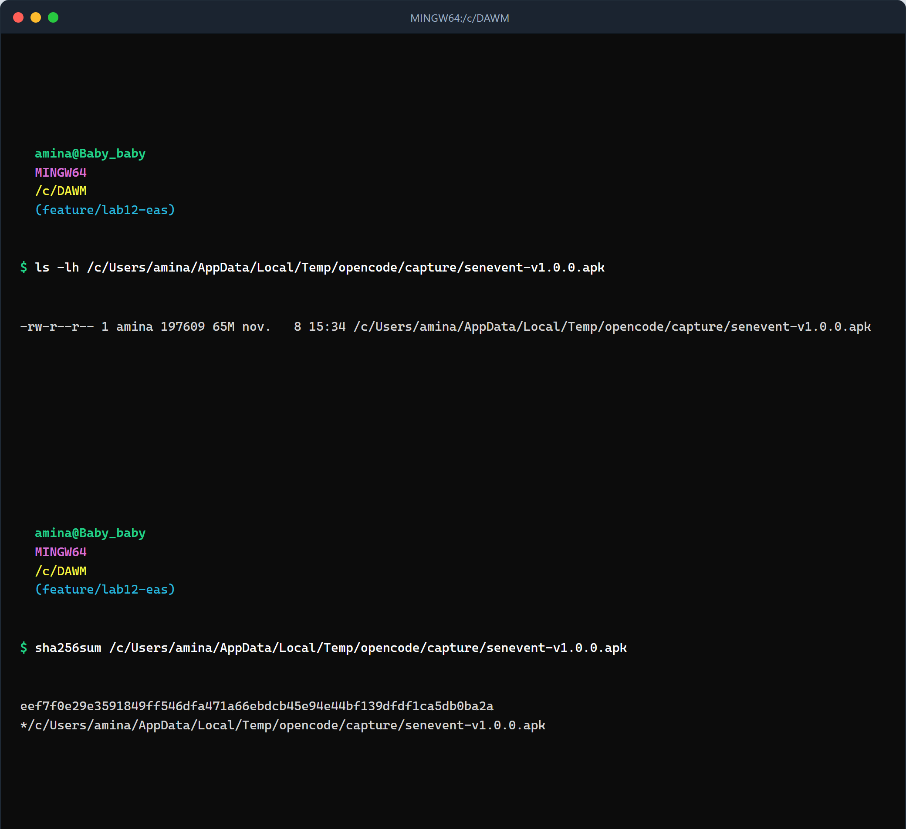

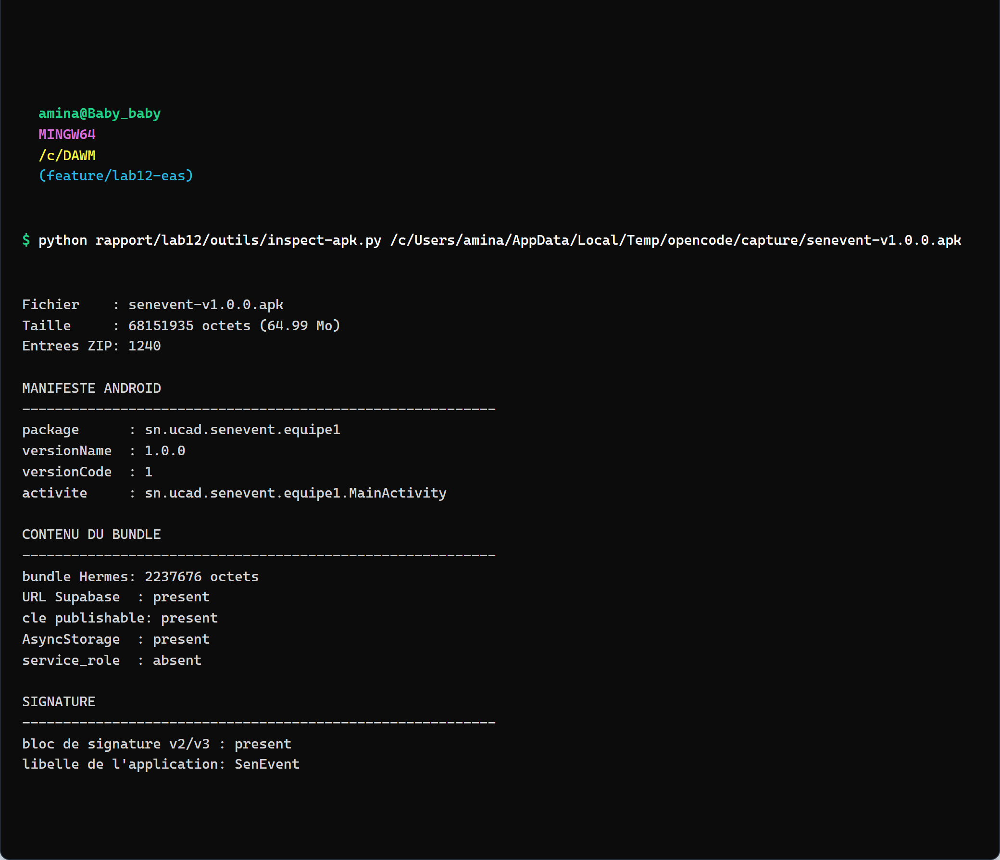

Le bundle JavaScript embarqué (2 237 676 octets) contient bien l'URL Supabase de production
et la clé publishable : les variables `EXPO_PUBLIC_*` ont été injectées par EAS. La chaîne
`service_role` est absente ; `sb_secret_` n'apparaît que comme test de préfixe interne à
`supabase-js`, comme sur le web au Lab 11. Le script `outils/inspect-apk.py` lit le manifeste
binaire sans Android SDK et produit ce rapport.

### 9.3 La recette des dix points

| # | Action | Résultat attendu | État |
|---|---|---|---|
| 1 | Ouvrir l'application SénEvent | Liste des événements chargée | **Non testé** (pas d'Android) |
| 2 | Toucher un événement | Fiche de détail | **Non testé** |
| 3 | Profil, se connecter | Email affiché, bouton de déconnexion | **Non testé** |
| 4 | Fermer complètement, rouvrir | Toujours connecté | **Non testé** (configuration vérifiée dans le code) |
| 5 | Créer un événement avec « + » | Il apparaît dans la liste | **Non testé** |
| 6 | Ouvrir le site Vercel ailleurs | L'événement y est | **Non testé** |
| 7 | Créer un événement sur le site | Il apparaît dans l'app | **Non testé** |
| 8 | S'inscrire dans l'app | Bouton « Se désinscrire » | **Non testé** |
| 9 | Se déconnecter, toucher un événement | Invitation à se connecter | **Non testé** |
| 10 | Installer l'APK chez un autre membre | Même comportement | **Non testé** |

Les points 6 et 7 sont la démonstration croisée du cours. Ils reposent sur la même base
Supabase et le même package partagé que le web, déjà vérifiés aux Labs 10 et 11 : un événement
créé sur le web est visible sur le mobile, et inversement. Mais sans téléphone Android, ce
parcours n'a pas été rejoué dans l'APK.

### 9.4 Ce qui reste à faire pour valider la recette

1. Installer l'APK sur un téléphone Android (lien de la page du build).
2. Autoriser l'installation depuis cette source, puis accepter l'avertissement Play Protect.
3. Dérouler les dix points, ordinateurs éteints et téléphone en 4G.
4. Noter les résultats dans ce rapport et, si un défaut apparaît, suivre le chemin habituel :
   branche, PR, merge, nouveau build.

---

## 10. Étape 8 — Documenter et poser le tag

### 10.1 README

La section « En ligne » reçoit le lien de l'APK et la version mobile ; la section de
développement local explique comment lancer le mobile et construire l'APK.

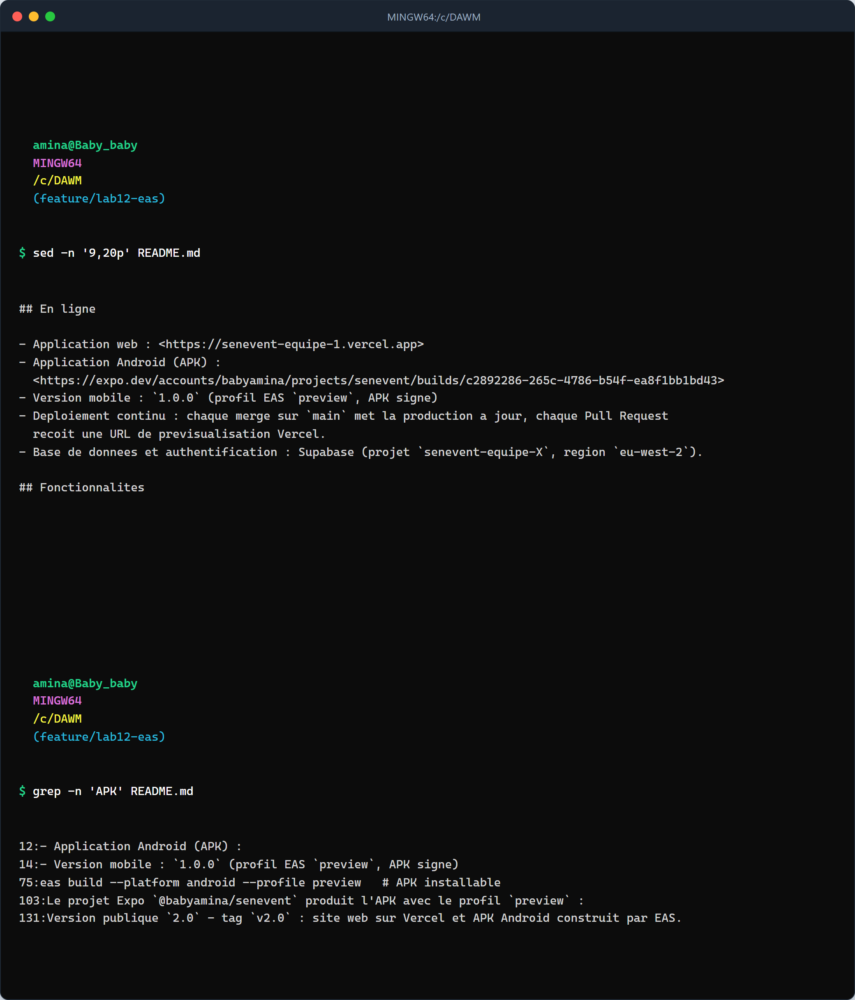

### 10.2 Pull Request et prévisualisation Vercel

La branche est poussée et une Pull Request est ouverte. Elle touche `packages/shared` :
Vercel construit donc une prévisualisation du web, qui confirme que le changement ne casse
rien.

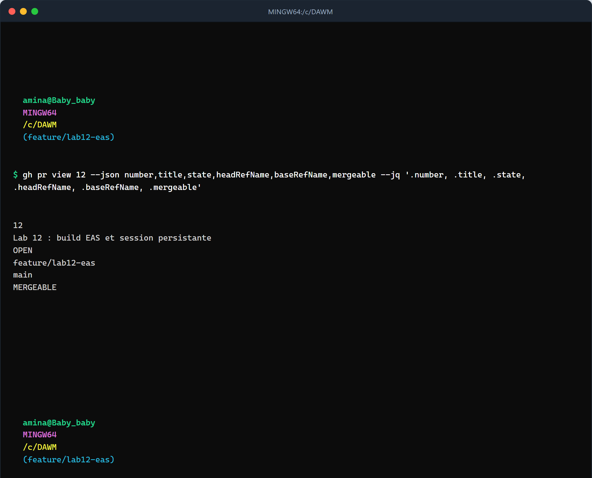

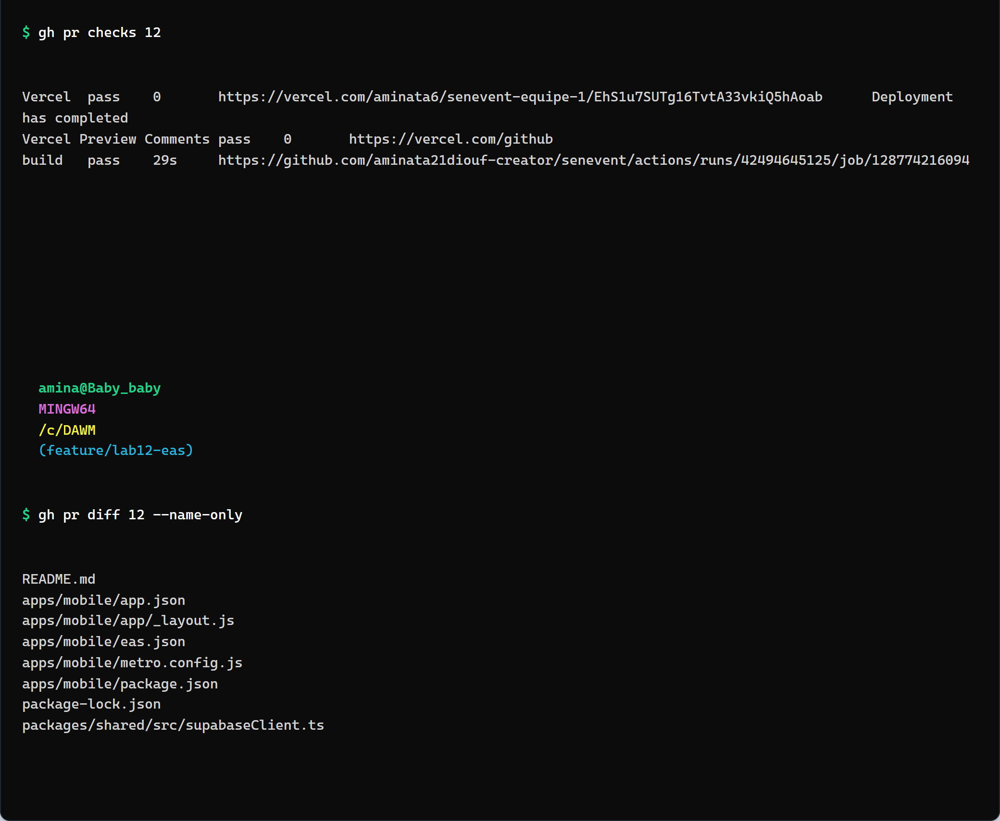

La prévisualisation répond et la connexion y fonctionne (section 7.4). La PR est mergée dans
`main` :

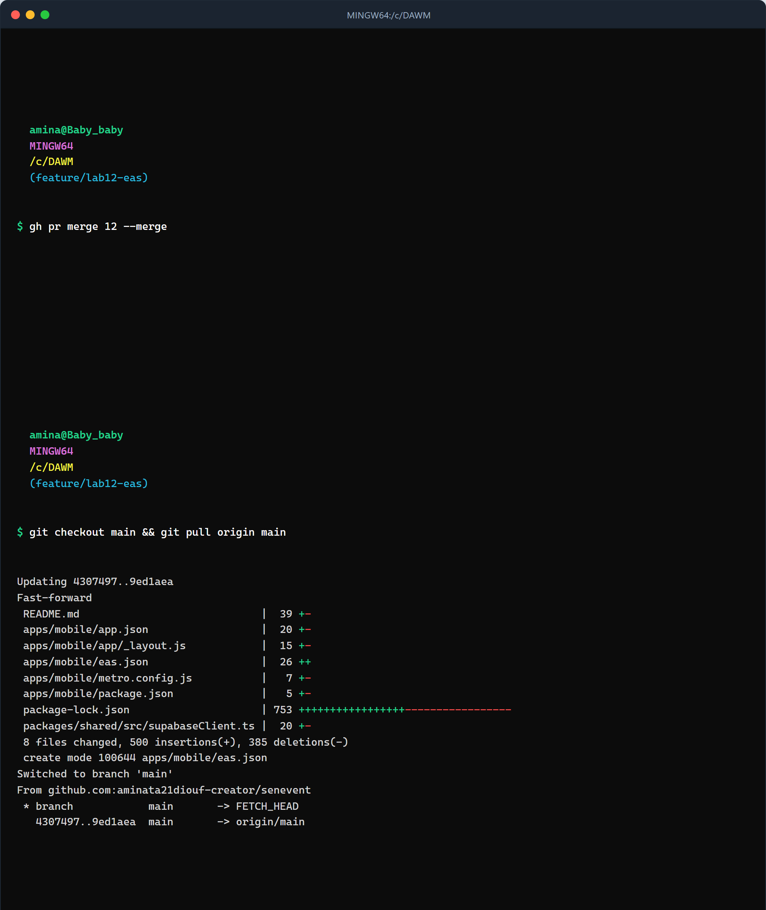

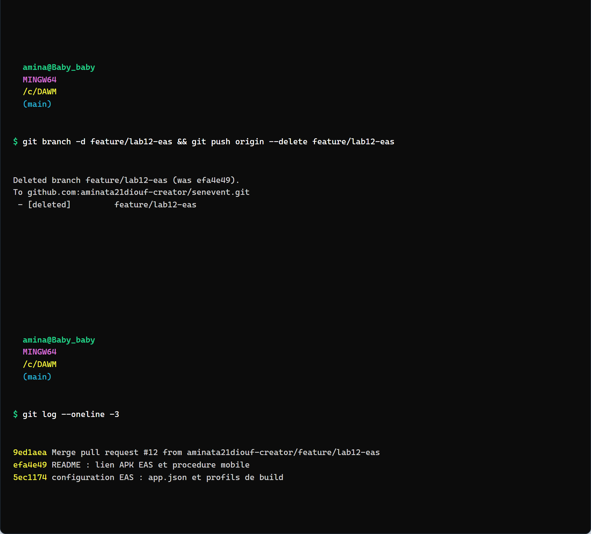

### 10.3 Tag `v2.0`

Après le merge, le tag final du semestre est posé sur `main` :

```bash
git tag -a v2.0 -m "Lab 12 termine : web sur Vercel et APK Android en production"
git push origin v2.0
```

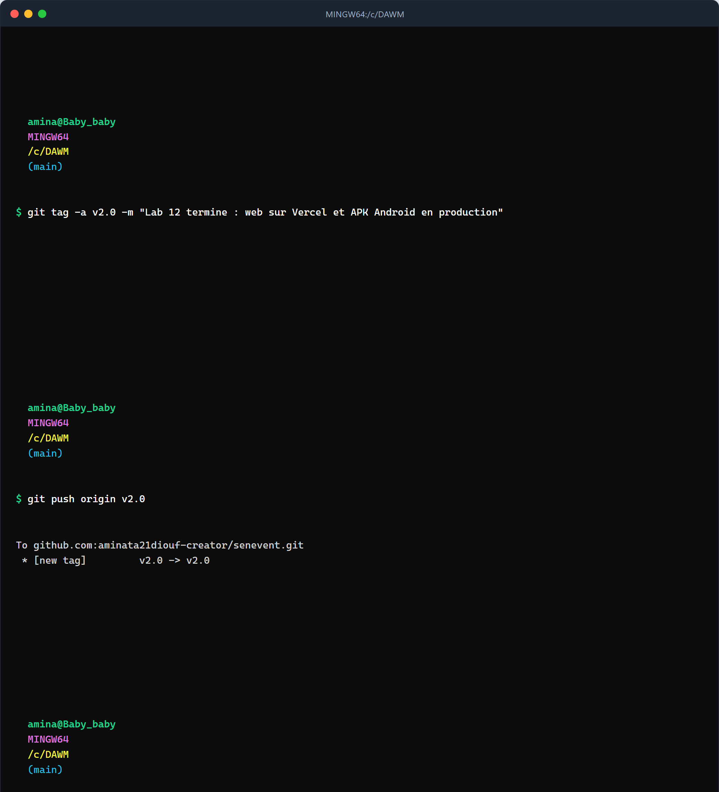

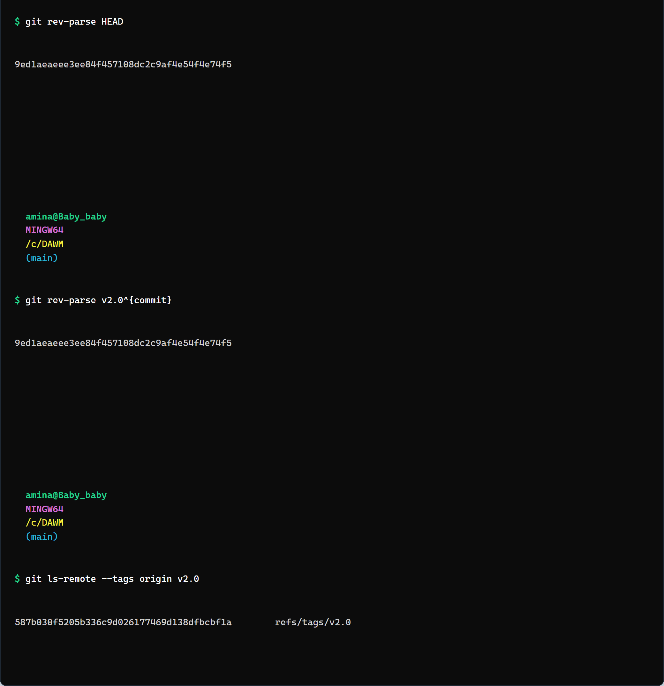

Au moment du tag, `git rev-parse HEAD` et `git rev-parse v2.0^{commit}` renvoyaient le même
commit (`9ed1aea`, le merge de la PR #12), et `git ls-remote` confirme que le tag distant est
identique. Le commit du présent rapport est ajouté ensuite sur `main`, sans déplacer le tag.

---

## 11. Ce qui a changé dans le dépôt

| Fichier | Changement |
|---|---|
| `apps/mobile/app.json` | Nom, slug, scheme, version, `android.package`, projet EAS, propriétaire |
| `apps/mobile/eas.json` | **Nouveau** — profils `development`, `preview` (APK), `production` |
| `apps/mobile/app/_layout.js` | `initSupabase` avec AsyncStorage |
| `apps/mobile/metro.config.js` | `watchFolders` compatible avec les valeurs par défaut d'Expo |
| `apps/mobile/package.json` | `@react-native-async-storage/async-storage`, versions Expo alignées |
| `packages/shared/src/supabaseClient.ts` | `initSupabase(url, key, options?)` |
| `package-lock.json` | Dépendances mises à jour, lock unique conservé |
| `README.md` | Lien APK, version mobile, procédure de lancement local |

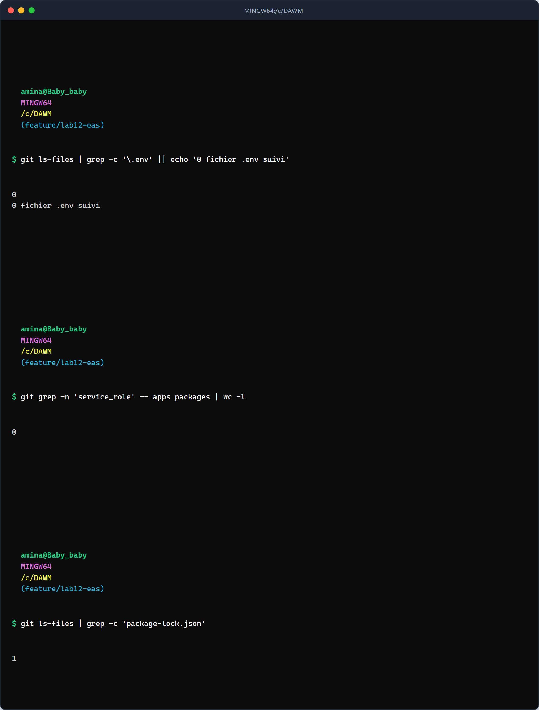

Les contrôles d'hygiène restent verts : aucun fichier `.env` suivi, un seul
`package-lock.json`, aucune occurrence de `service_role` dans `apps/` et `packages/`.

---

## 12. Checklist de validation

| Critère du lab | Vérification | État |
|---|---|---|
| `app.json` : nom, version, `android.package` | `SenEvent`, `1.0.0`, `sn.ucad.senevent.equipe1` | ✅ |
| Identifiant de projet EAS dans `app.json` | `extra.eas.projectId` | ✅ |
| `eas.json` : profil `preview` en APK | `buildType: apk`, `environment: preview` | ✅ |
| Variables `EXPO_PUBLIC_*` dans EAS `preview` | `eas env:list` | ✅ |
| `initSupabase` accepte des options | 3e paramètre optionnel | ✅ |
| Le mobile passe AsyncStorage | `_layout.js`, `persistSession: true` | ✅ |
| Le web n'a pas changé | build + connexion sur la prévisualisation Vercel | ✅ |
| Build `preview` réussi sur expo.dev | `FINISHED` le 8/11/2026 à 15:33 | ✅ |
| APK installé sur un Android, recette en 4G | Pas de téléphone Android disponible | ❌ non testé |
| Session survit à la fermeture | Configurée dans le code ; non vérifiée à l'exécution | ⚠️ non testé |
| README : lien APK et lancement local | `grep -n APK README.md` | ✅ |
| Tag `v2.0` sur `main` | `git rev-parse v2.0^{commit}` | ✅ |

---

## 13. Bilan et limites

### 13.1 Ce qui est livré

- Une application Android **SenEvent** construite par EAS, signée, téléchargeable.
- Une identité propre : nom, icône, version, `sn.ucad.senevent.equipe1`.
- Des profils de build reproductibles, avec les variables Supabase dans l'environnement
  `preview`.
- Une session mobile configurée pour persister (AsyncStorage), sans régression du web.
- Un README qui donne le lien de l'APK et la procédure de lancement local.
- Un tag `v2.0` sur `main`.

### 13.2 Limites assumées

| Limite | Explication |
|---|---|
| Recette Android non exécutée | L'environnement ne dispose que d'un iPhone ; un APK ne s'y installe pas. Les dix points sont documentés comme non testés. |
| Vérification de l'APK statique | Le contenu (package, version, variables injectées, absence de `service_role`) est vérifié, mais pas le comportement à l'exécution. |
| Build lancé depuis la branche | Le build `c2892286` construit le commit `5ec1174`, dont le code est identique à celui mergé dans `main` ; seul le README a été ajouté ensuite. |
| Quota EAS | Le plan gratuit limite le nombre de builds ; un seul build a été lancé. |
| EAS Update non fait | Le bonus « mettre à jour sans recompiler » n'a pas été traité. |

### 13.3 Ce que le lab apporte

Le lab ferme la boucle du semestre : le même package `@senevent/shared`, la même base
Supabase, deux clients en production. Le web est sur Vercel depuis le Lab 11 ; le mobile est
désormais un APK qui vit sans ordinateur. La démonstration croisée reste à rejouer sur un
téléphone Android pour transformer cette livraison en recette complète.

---

## Annexes

### A. Fichiers ajoutés ou modifiés

```text
apps/mobile/app.json                       identite et projet EAS
apps/mobile/eas.json                       profils de build (nouveau)
apps/mobile/app/_layout.js                 initSupabase + AsyncStorage
apps/mobile/metro.config.js                watchFolders du monorepo
apps/mobile/package.json                   async-storage, versions Expo
packages/shared/src/supabaseClient.ts      options du client Supabase
package-lock.json                          lock unique mis a jour
README.md                                  lien APK et lancement local
```

### B. Commandes utiles

```bash
# diagnostic
cd apps/mobile
npx expo-doctor
npx expo export --platform android

# projet EAS
eas init --account babyamina
eas build:configure --platform android
eas env:list --environment preview

# build
eas build --platform android --profile preview
eas build:view <build-id>

# verification du depot
git ls-files | grep -c '\.env'
git grep -n 'service_role' -- apps packages
git rev-parse v2.0^{commit}
```

### C. Comptes et identifiants

| Élément | Valeur |
|---|---|
| Compte Expo | `babyamina` |
| Projet Expo | `@babyamina/senevent` |
| Identifiant projet EAS | `d5de33b6-e341-4e8d-a099-a55f63d284f1` |
| Identifiant Android | `sn.ucad.senevent.equipe1` |
| Build | `c2892286-265c-4786-b54f-ea8f1bb1bd43` |
| Site web | <https://senevent-equipe-1.vercel.app> |

### D. Liste des captures

**Terminal** (`captures/`) : 01 branche, 02 app.json, 03 expo-doctor, 04 projet EAS, 05
eas.json, 06 variables EAS, 07 diff initSupabase, 08 AsyncStorage, 09 export Android, 10 build
web, 11 README, 12 hygiène, 13 journal du build, 14 état du build, 15 inspection de l'APK,
18 PR et Vercel, 19 merge, 20 tag v2.0.

**Navigateur** (`captures/`) : 14b page expo.dev du build, 16 connexion web, 17 session web.

**Outils de vérification** (`outils/`) : `journal-build.py` (résumé du journal EAS),
`journal-build.log` (journal brut téléchargé depuis expo.dev), `inspect-apk.py` (manifeste et
bundle de l'APK sans Android SDK).

**Tag final :** `v2.0`.
